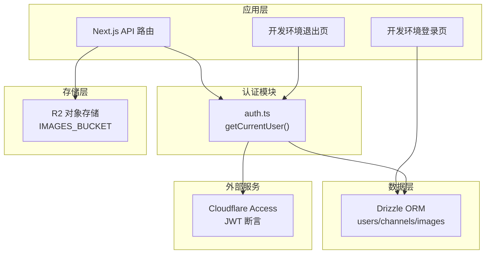
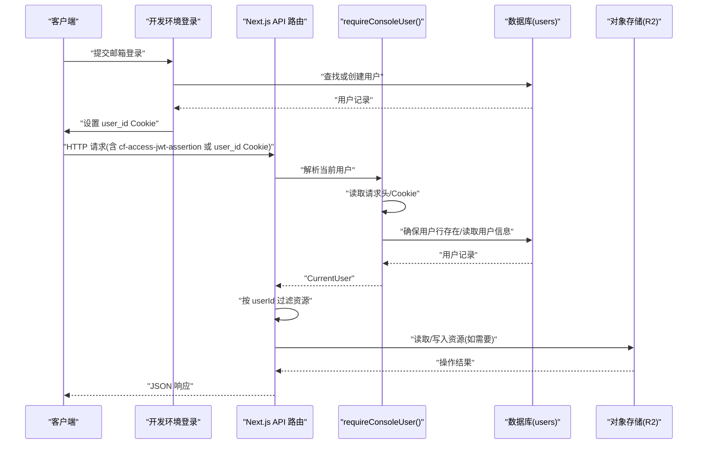
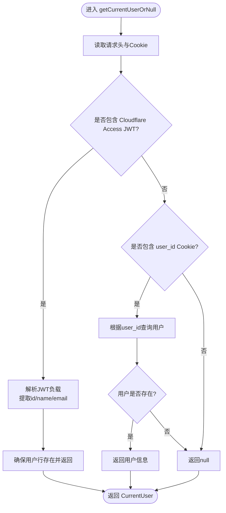
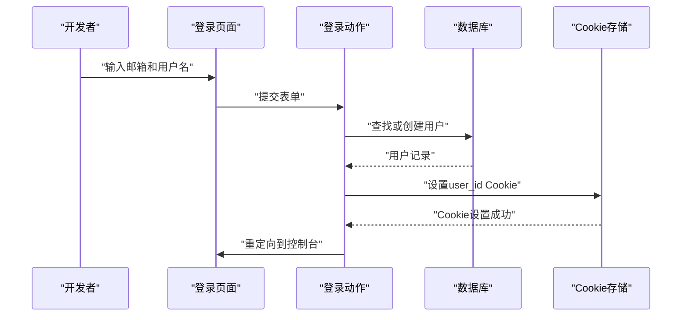
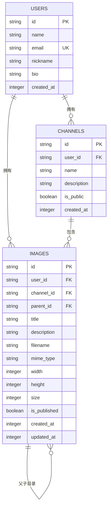
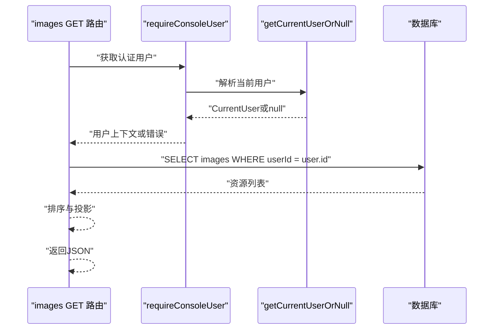
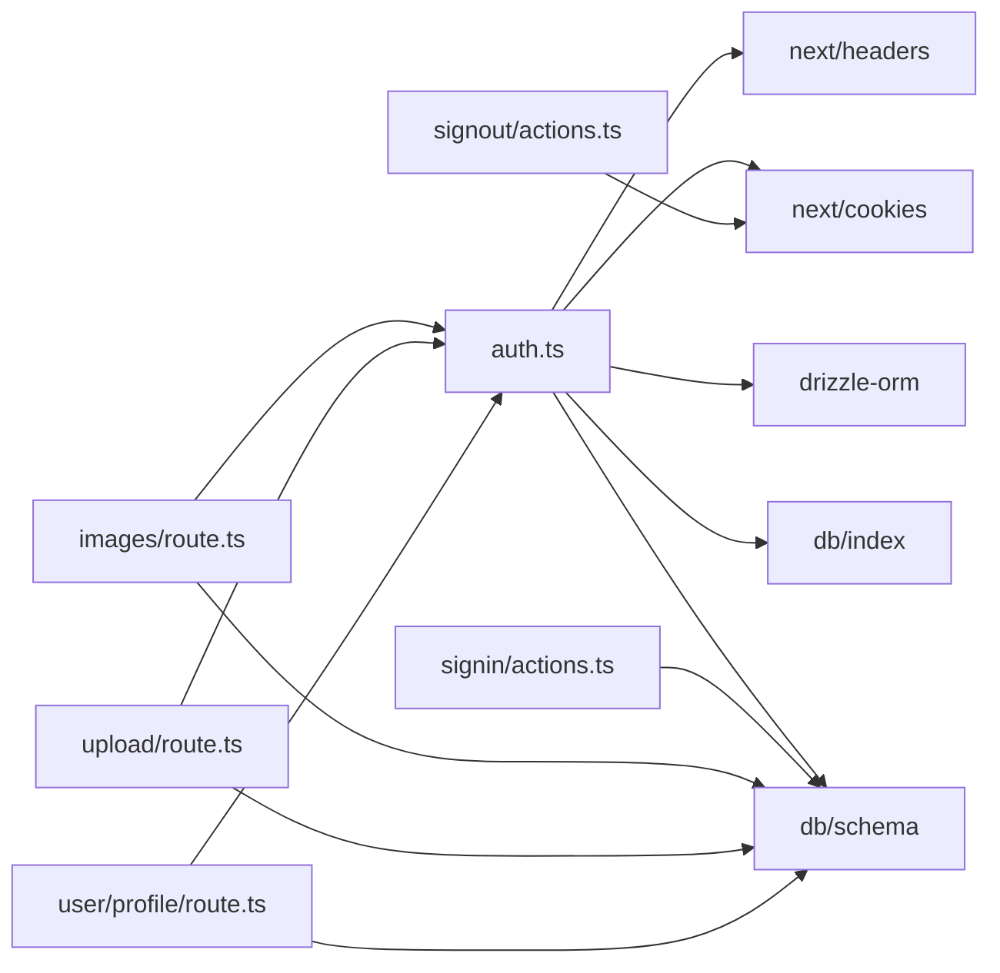

# 认证系统

<cite>
**本文引用的文件**   
- [src/lib/auth.ts](file://src/lib/auth.ts)
- [src/app/[lang]/account/signin/page.tsx](file://src/app/[lang]/account/signin/page.tsx)
- [src/app/[lang]/account/signin/actions.ts](file://src/app/[lang]/account/signin/actions.ts)
- [src/app/[lang]/account/signin/sign-in-form.tsx](file://src/app/[lang]/account/signin/sign-in-form.tsx)
- [src/app/[lang]/account/signout/page.tsx](file://src/app/[lang]/account/signout/page.tsx)
- [src/app/[lang]/account/signout/actions.ts](file://src/app/[lang]/account/signout/actions.ts)
- [src/db/schema.ts](file://src/db/schema.ts)
- [src/app/[lang]/console/api/images/route.ts](file://src/app/[lang]/console/api/images/route.ts)
- [src/app/[lang]/console/api/upload/route.ts](file://src/app/[lang]/console/api/upload/route.ts)
- [src/app/[lang]/console/api/user/profile/route.ts](file://src/app/[lang]/console/api/user/profile/route.ts)
- [wrangler.jsonc](file://wrangler.jsonc)
</cite>

## 更新摘要
**变更内容**   
- 新增开发环境模拟登录/退出功能，包括 sign-in 和 sign-out 页面及表单组件
- 移除了自动开发用户回退逻辑，现在开发环境需要通过显式登录页面进行身份验证
- 更新了认证流程章节以反映新的开发环境认证机制
- 新增了开发环境模拟登录模块的详细文档

## 目录
1. [简介](#简介)
2. [项目结构](#项目结构)
3. [核心组件](#核心组件)
4. [架构总览](#架构总览)
5. [详细组件分析](#详细组件分析)
6. [依赖关系分析](#依赖关系分析)
7. [性能考虑](#性能考虑)
8. [故障排查指南](#故障排查指南)
9. [结论](#结论)
10. [附录](#附录)

## 简介
本文件为 Weable 的认证系统提供全面文档，覆盖多源认证机制（Cloudflare Access JWT 与传统 Cookie）、开发环境模拟登录、用户信息管理（数据模型、会话与权限控制）、认证流程（请求拦截、令牌验证、用户信息提取、权限检查），以及 Next.js API 路由中的集成示例、配置选项、安全最佳实践与错误处理策略。同时说明与 Cloudflare Workers/Next.js 中间件的集成方式与自定义认证提供者的扩展方法。

## 项目结构
认证相关代码主要分布在以下位置：
- 认证逻辑与用户解析：src/lib/auth.ts
- 开发环境模拟登录：src/app/[lang]/account/signin/*
- 开发环境模拟退出：src/app/[lang]/account/signout/*
- 数据库模型与关系：src/db/schema.ts
- 使用认证的 API 路由：src/app/[lang]/console/api/* 下的多个 route.ts
- 部署与环境配置：wrangler.jsonc

图表来源
- [src/lib/auth.ts:87-124](file://src/lib/auth.ts#L87-L124)
- [src/app/[lang]/account/signin/actions.ts:16-50](file://src/app/[lang]/account/signin/actions.ts#L16-L50)
- [src/app/[lang]/account/signout/actions.ts:7-12](file://src/app/[lang]/account/signout/actions.ts#L7-L12)
- [src/db/schema.ts:26-33](file://src/db/schema.ts#L26-L33)
- [wrangler.jsonc:23-32](file://wrangler.jsonc#L23-L32)

章节来源
- [src/lib/auth.ts:1-125](file://src/lib/auth.ts#L1-L125)
- [src/app/[lang]/account/signin/page.tsx:1-33](file://src/app/[lang]/account/signin/page.tsx#L1-L33)
- [src/app/[lang]/account/signout/page.tsx:1-59](file://src/app/[lang]/account/signout/page.tsx#L1-L59)
- [src/db/schema.ts:1-100](file://src/db/schema.ts#L1-L100)
- [wrangler.jsonc:1-34](file://wrangler.jsonc#L1-L34)

## 核心组件
- 当前用户解析器 getCurrentUser：统一从请求头或 Cookie 中获取认证凭据，优先 Cloudflare Access JWT，其次传统 session cookie，生产环境无身份时返回 null。
- 开发环境模拟登录：通过 sign-in 页面实现邮箱驱动的模拟登录，支持新建用户或匹配现有用户，设置 user_id Cookie 维持会话。
- 开发环境模拟退出：通过 sign-out 页面清除 user_id Cookie，实现幂等的登出操作。
- 用户数据模型 users：包含 id、name、email、nickname、bio、createdAt 等字段，作为所有业务资源的归属主体。
- 资源访问鉴权：API 路由通过 requireConsoleUser 获取用户上下文，并在查询条件中强制绑定 userId，实现基于用户的资源隔离。

章节来源
- [src/lib/auth.ts:87-124](file://src/lib/auth.ts#L87-L124)
- [src/app/[lang]/account/signin/actions.ts:16-50](file://src/app/[lang]/account/signin/actions.ts#L16-L50)
- [src/app/[lang]/account/signout/actions.ts:7-12](file://src/app/[lang]/account/signout/actions.ts#L7-L12)
- [src/db/schema.ts:26-33](file://src/db/schema.ts#L26-L33)
- [src/app/[lang]/console/api/images/route.ts:17-21](file://src/app/[lang]/console/api/images/route.ts#L17-L21)

## 架构总览
下图展示一次受保护 API 请求的端到端流程：客户端携带 Cloudflare Access JWT 或开发环境 user_id Cookie，Next.js 路由调用 requireConsoleUser 解析身份，随后进行资源级权限校验并返回结果。

图表来源
- [src/lib/auth.ts:97-124](file://src/lib/auth.ts#L97-L124)
- [src/app/[lang]/account/signin/actions.ts:16-50](file://src/app/[lang]/account/signin/actions.ts#L16-L50)
- [src/db/schema.ts:26-33](file://src/db/schema.ts#L26-L33)
- [wrangler.jsonc:23-32](file://wrangler.jsonc#L23-L32)

## 详细组件分析

### 多源认证机制
- Cloudflare Access JWT 认证
  - 支持从请求头 cf-access-jwt-assertion 或 Cookie CF_Authorization/cf_authorization 中读取 JWT。
  - 对 JWT payload 进行 Base64Url 解码与 JSON 解析，提取 sub、email、name/preferred_username/common_name 等字段，构造身份标识。
- 传统 Cookie 认证
  - 若未检测到 Cloudflare Access JWT，则尝试从 Cookie user_id 解析用户标识，并通过数据库查询还原真实用户信息。
- **更新** 开发环境模拟登录
  - 移除了自动开发用户回退逻辑，现在开发环境必须通过 /account/signin 页面进行显式登录。
  - 支持邮箱格式校验，可匹配现有用户或自动创建新用户。
  - 登录后设置 httpOnly、sameSite=lax 的 user_id Cookie 维持会话。

图表来源
- [src/lib/auth.ts:97-124](file://src/lib/auth.ts#L97-L124)
- [src/app/[lang]/account/signin/actions.ts:16-50](file://src/app/[lang]/account/signin/actions.ts#L16-L50)

章节来源
- [src/lib/auth.ts:58-72](file://src/lib/auth.ts#L58-L72)
- [src/lib/auth.ts:97-124](file://src/lib/auth.ts#L97-L124)
- [src/app/[lang]/account/signin/actions.ts:16-50](file://src/app/[lang]/account/signin/actions.ts#L16-L50)

### 开发环境模拟登录模块
- 登录页面组件
  - 仅开发环境可用，生产环境直接返回 404。
  - 提供邮箱和用户名称输入表单，支持实时状态反馈。
- 登录动作处理
  - 邮箱格式验证：非空 local 段 + @ + 非空 domain 段。
  - 用户查找或创建：按邮箱匹配现有用户，不存在则自动创建。
  - 会话管理：设置 httpOnly、sameSite=lax 的 user_id Cookie。
  - 重定向：登录成功后跳转到控制台页面。
- 退出页面组件
  - 显示当前登录用户信息，提供退出按钮。
  - 未登录状态显示前往登录链接。
- 退出动作处理
  - 删除 user_id Cookie，实现幂等登出。
  - 重定向回登录页面。

图表来源
- [src/app/[lang]/account/signin/page.tsx:13-32](file://src/app/[lang]/account/signin/page.tsx#L13-L32)
- [src/app/[lang]/account/signin/actions.ts:16-50](file://src/app/[lang]/account/signin/actions.ts#L16-L50)
- [src/app/[lang]/account/signout/actions.ts:7-12](file://src/app/[lang]/account/signout/actions.ts#L7-L12)

章节来源
- [src/app/[lang]/account/signin/page.tsx:1-33](file://src/app/[lang]/account/signin/page.tsx#L1-L33)
- [src/app/[lang]/account/signin/actions.ts:1-51](file://src/app/[lang]/account/signin/actions.ts#L1-L51)
- [src/app/[lang]/account/signin/sign-in-form.tsx:1-56](file://src/app/[lang]/account/signin/sign-in-form.tsx#L1-L56)
- [src/app/[lang]/account/signout/page.tsx:1-59](file://src/app/[lang]/account/signout/page.tsx#L1-L59)
- [src/app/[lang]/account/signout/actions.ts:1-13](file://src/app/[lang]/account/signout/actions.ts#L1-L13)

### 用户信息管理模块
- 数据模型 users
  - 主键 id 使用 uuidv7 编码为 base58 的字符串，具备时间有序性。
  - name、email 必填，email 唯一；nickname、bio 可选；createdAt 默认当前时间。
- 会话管理
  - 当前实现不维护服务端会话表，依赖 Cloudflare Access JWT 或 Cookie user_id 作为会话载体。
  - ensureUserRow 保证每次认证后用户在数据库中至少有一条记录，便于后续扩展权限与资料。
- 权限控制
  - 资源级权限通过 userId 绑定实现，所有查询均强制附加 eq(images.userId, user.id) 等条件，防止越权访问。
  - 可扩展角色/权限模型（例如 roles、permissions）与 RBAC/ABAC 策略。

图表来源
- [src/db/schema.ts:26-99](file://src/db/schema.ts#L26-L99)

章节来源
- [src/db/schema.ts:1-100](file://src/db/schema.ts#L1-L100)
- [src/lib/auth.ts:74-85](file://src/lib/auth.ts#L74-L85)

### 认证流程在各阶段的应用
- 请求拦截
  - Next.js API 路由入口调用 requireConsoleUser，完成身份解析与用户上下文注入。
- 令牌验证
  - Cloudflare Access JWT 由 Cloudflare 签发与校验，应用侧仅做负载解析与字段映射。
  - 传统 Cookie 模式依赖前端/网关正确设置 user_id。
- 用户信息提取
  - 从 JWT payload 或 Cookie 中提取 id、name、email，并通过 ensureUserRow 同步至数据库。
- 权限检查
  - 业务路由在查询时强制附加 userId 条件，实现资源隔离。

图表来源
- [src/app/[lang]/console/api/images/route.ts:17-21](file://src/app/[lang]/console/api/images/route.ts#L17-L21)
- [src/lib/auth.ts:97-124](file://src/lib/auth.ts#L97-L124)

章节来源
- [src/app/[lang]/console/api/images/route.ts:1-122](file://src/app/[lang]/console/api/images/route.ts#L1-L122)
- [src/lib/auth.ts:97-124](file://src/lib/auth.ts#L97-L124)

### API 路由集成示例
- 获取图片列表
  - 通过 requireConsoleUser 获取用户上下文，并按 userId 过滤目录与文件，支持 parentId 参数限定子目录。
- 上传图片
  - 校验文件类型与大小，限制批量数量；将文件写入 R2，并在数据库中创建元数据记录。
- 更新用户资料
  - PATCH /user/profile 允许更新 nickname、bio，并进行长度与类型校验。

章节来源
- [src/app/[lang]/console/api/images/route.ts:17-103](file://src/app/[lang]/console/api/images/route.ts#L17-L103)
- [src/app/[lang]/console/api/upload/route.ts:16-80](file://src/app/[lang]/console/api/upload/route.ts#L16-L80)
- [src/app/[lang]/console/api/user/profile/route.ts:11-36](file://src/app/[lang]/console/api/user/profile/route.ts#L11-L36)

### 与 Next.js 中间件和 Cloudflare 的集成
- Next.js 运行时
  - 各 API 路由声明 runtime: "nodejs"，以便在服务端执行认证与数据库操作。
- Cloudflare 部署
  - wrangler.jsonc 配置 D1 数据库与 R2 存储桶绑定，OpenNext 构建产物运行于 Cloudflare Workers。
- 中间件扩展点
  - 可在 Next.js 中间件中统一拦截请求，注入认证上下文或重定向未登录用户；或在 Cloudflare Pages/Workers 层前置 Access 校验。

章节来源
- [src/app/[lang]/console/api/images/route.ts:7](file://src/app/[lang]/console/api/images/route.ts#L7)
- [src/app/[lang]/console/api/upload/route.ts:8](file://src/app/[lang]/console/api/upload/route.ts#L8)
- [src/app/[lang]/console/api/user/profile/route.ts:7](file://src/app/[lang]/console/api/user/profile/route.ts#L7)
- [wrangler.jsonc:16-32](file://wrangler.jsonc#L16-L32)

### 自定义认证提供者的扩展方法
- 在 getCurrentUserOrNull 中新增分支，优先读取新的认证来源（如自定义 Header、第三方 Token）。
- 定义统一的身份映射函数，将不同来源的标识映射为 id/name/email。
- 保持 ensureUserRow 的幂等插入与读取行为，确保新来源的用户也能落库。
- 在 API 路由中无需改动，仍通过 requireConsoleUser 获取用户上下文。

章节来源
- [src/lib/auth.ts:97-124](file://src/lib/auth.ts#L97-L124)
- [src/lib/auth.ts:74-85](file://src/lib/auth.ts#L74-L85)

## 依赖关系分析
- 认证模块依赖
  - next/headers 与 next/cookies：读取请求头与 Cookie。
  - drizzle-orm：数据库查询与插入。
  - db/index 与 db/schema：数据库连接与表结构。
- API 路由依赖
  - 各路由依赖 auth 获取用户上下文，依赖 schema 进行数据操作，依赖 storage 进行对象存储。
- 部署依赖
  - wrangler.jsonc 绑定 D1 与 R2，确保运行时可用。

图表来源
- [src/lib/auth.ts:1-6](file://src/lib/auth.ts#L1-L6)
- [src/app/[lang]/console/api/images/route.ts:1-6](file://src/app/[lang]/console/api/images/route.ts#L1-L6)
- [src/app/[lang]/console/api/upload/route.ts:1-7](file://src/app/[lang]/console/api/upload/route.ts#L1-L7)
- [src/app/[lang]/console/api/user/profile/route.ts:1-5](file://src/app/[lang]/console/api/user/profile/route.ts#L1-L5)
- [src/app/[lang]/account/signin/actions.ts:1-8](file://src/app/[lang]/account/signin/actions.ts#L1-L8)
- [src/app/[lang]/account/signout/actions.ts:1-5](file://src/app/[lang]/account/signout/actions.ts#L1-L5)

章节来源
- [src/lib/auth.ts:1-6](file://src/lib/auth.ts#L1-L6)
- [src/app/[lang]/console/api/images/route.ts:1-6](file://src/app/[lang]/console/api/images/route.ts#L1-L6)
- [src/app/[lang]/console/api/upload/route.ts:1-7](file://src/app/[lang]/console/api/upload/route.ts#L1-L7)
- [src/app/[lang]/console/api/user/profile/route.ts:1-5](file://src/app/[lang]/console/api/user/profile/route.ts#L1-L5)
- [src/app/[lang]/account/signin/actions.ts:1-8](file://src/app/[lang]/account/signin/actions.ts#L1-L8)
- [src/app/[lang]/account/signout/actions.ts:1-5](file://src/app/[lang]/account/signout/actions.ts#L1-L5)

## 性能考虑
- JWT 解析轻量：仅 Base64Url 解码与 JSON 解析，开销较小。
- 数据库访问最小化：ensureUserRow 使用 onConflictDoNothing 避免重复插入，减少写放大。
- 查询条件优化：在路由层以 userId 精确过滤，避免全表扫描。
- 存储读写分离：认证逻辑不涉及 I/O 密集型操作，I/O 集中在上传与头像接口。
- **更新** 开发环境登录优化：邮箱查找使用索引优化，新用户创建采用幂等操作。

## 故障排查指南
- 无法解析已认证用户
  - 现象：抛出"未能从 Cloudflare Access JWT 或会话 Cookie 解析用户"的错误。
  - 排查：确认请求头 cf-access-jwt-assertion 或 Cookie CF_Authorization/cf_authorization 是否存在；检查 user_id Cookie 是否正确设置。
- 开发环境登录失败
  - 现象：登录页面报错或无法跳转。
  - 排查：确认 NODE_ENV 是否为 development；检查邮箱格式是否符合验证规则；确认数据库连接正常。
- 资源 404 或权限不足
  - 现象：查询不到图片或目录。
  - 排查：确认 userId 是否正确绑定；检查 parentId 是否存在且属于当前用户。
- 上传失败
  - 现象：文件类型不允许、超过大小限制、父目录不存在。
  - 排查：校验 ALLOWED_MIME_PREFIXES、MAX_FILE_SIZE_BYTES、MAX_UPLOAD_FILES；确认 parentId 指向有效的目录资源。

章节来源
- [src/lib/auth.ts:89-91](file://src/lib/auth.ts#L89-L91)
- [src/app/[lang]/account/signin/actions.ts:21-26](file://src/app/[lang]/account/signin/actions.ts#L21-L26)
- [src/app/[lang]/console/api/images/route.ts:38-53](file://src/app/[lang]/console/api/images/route.ts#L38-L53)
- [src/app/[lang]/console/api/upload/route.ts:27-55](file://src/app/[lang]/console/api/upload/route.ts#L27-L55)

## 结论
Weable 的认证系统以 getCurrentUser 为核心，统一了 Cloudflare Access JWT 与传统 Cookie 两种认证来源，并通过 ensureUserRow 将用户信息持久化，结合路由层的 userId 过滤实现资源级权限控制。**更新** 新增的开发环境模拟登录功能提供了更安全的本地开发体验，移除了自动开发用户回退逻辑，要求开发者通过显式登录页面进行身份验证。该设计简洁可靠，易于扩展新的认证提供者，并与 Next.js 及 Cloudflare 生态良好集成。建议在生产环境中启用严格的 JWT 校验与安全的 Cookie 策略，持续完善权限模型与审计日志。

## 附录
- 配置选项
  - Cloudflare Access：确保 cf-access-jwt-assertion 或 CF_Authorization/cf_authorization 正确传递。
  - 开发环境：NODE_ENV=development 时启用 /account/signin 和 /account/signout 页面。
  - 运行时：API 路由需声明 runtime: "nodejs"。
  - 部署绑定：wrangler.jsonc 中配置 D1 与 R2 绑定名称与 ID。
- 安全最佳实践
  - 在生产环境禁用开发登录页面（已通过 NODE_ENV 检查实现）。
  - 对 Cookie 设置 HttpOnly、Secure、SameSite。
  - 限制上传类型与大小，校验父目录所有权。
  - 定期轮换密钥与审查 JWT 载荷字段。
  - **更新** 开发环境登录仅用于本地调试，不应在生产环境启用。

章节来源
- [src/app/[lang]/account/signin/page.tsx:14](file://src/app/[lang]/account/signin/page.tsx#L14)
- [src/app/[lang]/account/signout/page.tsx:16](file://src/app/[lang]/account/signout/page.tsx#L16)
- [src/app/[lang]/account/signin/actions.ts:43-47](file://src/app/[lang]/account/signin/actions.ts#L43-L47)
- [wrangler.jsonc:16-32](file://wrangler.jsonc#L16-L32)