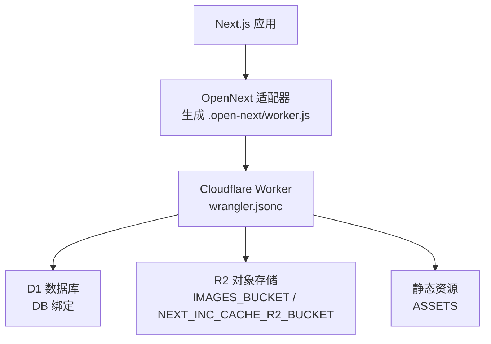
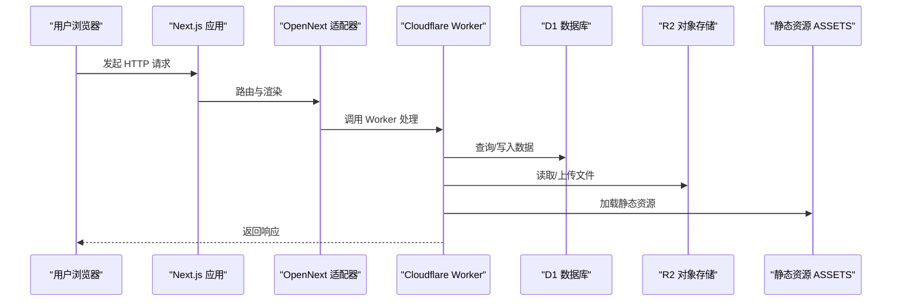
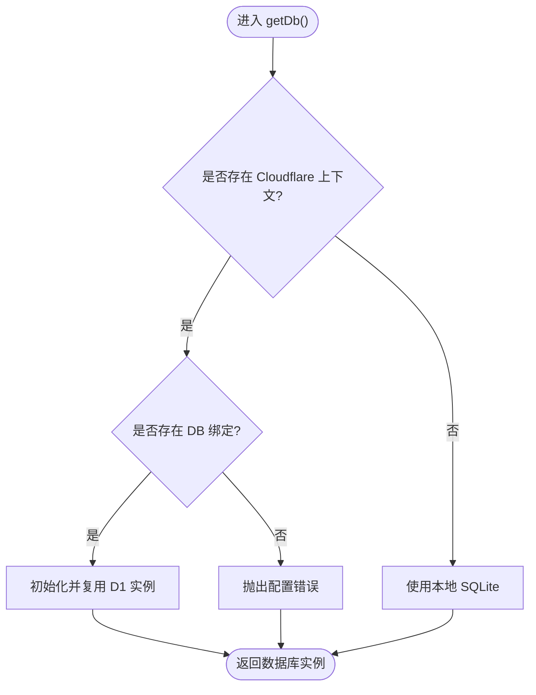
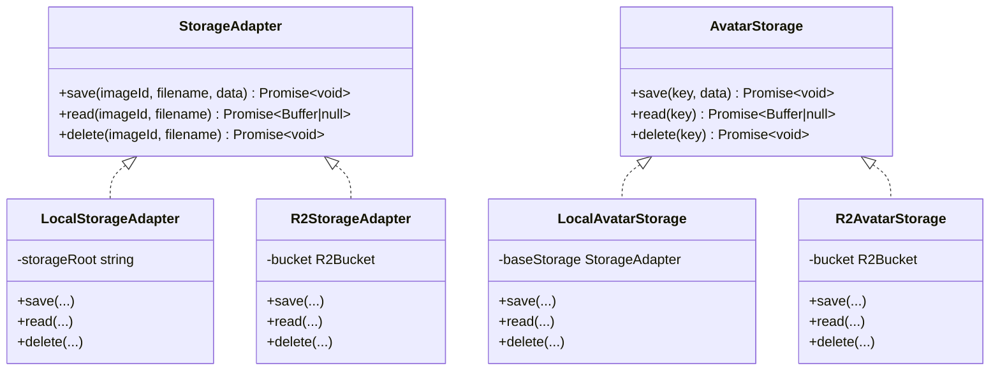
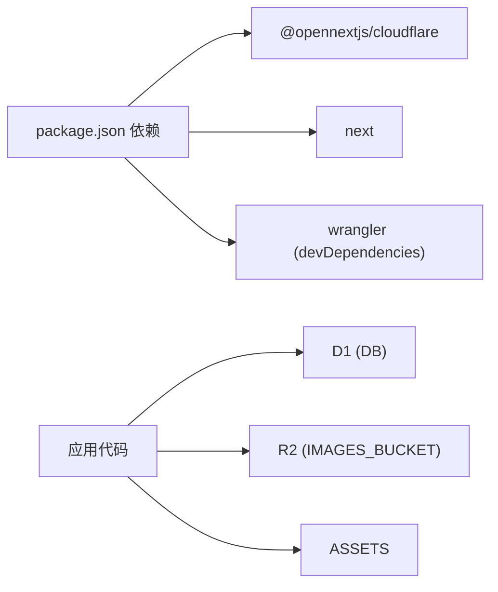

# Cloudflare 部署

<cite>
**本文引用的文件**   
- [wrangler.jsonc](file://wrangler.jsonc)
- [open-next.config.ts](file://open-next.config.ts)
- [package.json](file://package.json)
- [next.config.ts](file://next.config.ts)
- [worker-configuration.d.ts](file://worker-configuration.d.ts)
- [src/db/index.ts](file://src/db/index.ts)
- [src/lib/storage.ts](file://src/lib/storage.ts)
</cite>

## 目录
1. [简介](#简介)
2. [项目结构](#项目结构)
3. [核心组件](#核心组件)
4. [架构总览](#架构总览)
5. [详细组件分析](#详细组件分析)
6. [依赖关系分析](#依赖关系分析)
7. [性能考虑](#性能考虑)
8. [故障排查指南](#故障排查指南)
9. [结论](#结论)
10. [附录](#附录)

## 简介
本指南面向在 Cloudflare Workers 上部署 Weable（基于 Next.js）的工程师与运维人员，围绕以下目标展开：
- 详解 wrangler.jsonc 配置项（兼容性日期、主入口、可观测性、资源绑定等）
- 说明 OpenNext 适配器的关键配置选项，确保 Next.js 应用在 Workers 环境正确运行
- 提供 Cloudflare CLI（Wrangler）的安装与使用方式（构建、部署、环境变量管理）
- 给出多环境部署策略（开发、测试、生产）与版本管理最佳实践

## 项目结构
Weable 采用 Next.js + OpenNext + Cloudflare Workers 的技术栈。关键配置文件与运行时类型定义如下：
- wrangler.jsonc：Workers 应用配置（名称、兼容性、主入口、可观测性、静态资源、D1/R2 绑定）
- open-next.config.ts：OpenNext Cloudflare 适配器配置（缓存等）
- next.config.ts：Next.js 基础配置（页面扩展、严格模式、本地开发源白名单）
- worker-configuration.d.ts：Cloudflare 运行时类型（D1、R2、环境变量）
- src/db/index.ts：数据库访问抽象（本地 SQLite 与 D1 自动切换）
- src/lib/storage.ts：存储适配器（本地文件系统与 R2 自动切换）

图表来源
- [wrangler.jsonc:1-34](file://wrangler.jsonc#L1-L34)
- [open-next.config.ts:1-10](file://open-next.config.ts#L1-L10)
- [next.config.ts:1-15](file://next.config.ts#L1-L15)

章节来源
- [wrangler.jsonc:1-34](file://wrangler.jsonc#L1-L34)
- [open-next.config.ts:1-10](file://open-next.config.ts#L1-L10)
- [next.config.ts:1-15](file://next.config.ts#L1-L15)
- [worker-configuration.d.ts:1-39](file://worker-configuration.d.ts#L1-L39)

## 核心组件
- Wrangler 配置（wrangler.jsonc）
  - name：Worker 名称
  - compatibility_date：运行时兼容性日期
  - main：主入口文件（由 OpenNext 生成）
  - observability：开启可观测性
  - compatibility_flags：启用 Node.js 兼容特性
  - assets：静态资源目录与绑定名
  - d1_databases：D1 数据库绑定
  - r2_buckets：R2 桶绑定（含增量缓存专用绑定）
- OpenNext 适配器（open-next.config.ts）
  - 通过 defineCloudflareConfig 暴露可扩展点（如 R2 增量缓存）
- Next.js 配置（next.config.ts）
  - pageExtensions、reactStrictMode、allowedDevOrigins
- 运行时类型（worker-configuration.d.ts）
  - 声明 D1、R2、CloudflareEnv 等类型，供 TS 编译期检查

章节来源
- [wrangler.jsonc:1-34](file://wrangler.jsonc#L1-L34)
- [open-next.config.ts:1-10](file://open-next.config.ts#L1-L10)
- [next.config.ts:1-15](file://next.config.ts#L1-L15)
- [worker-configuration.d.ts:1-39](file://worker-configuration.d.ts#L1-L39)

## 架构总览
下图展示了从请求到数据层的关键路径：Next.js 页面/API → OpenNext 生成的 Worker → Cloudflare 运行时 → D1/R2/ASSETS。

图表来源
- [wrangler.jsonc:1-34](file://wrangler.jsonc#L1-L34)
- [open-next.config.ts:1-10](file://open-next.config.ts#L1-L10)
- [src/db/index.ts:1-61](file://src/db/index.ts#L1-L61)
- [src/lib/storage.ts:1-214](file://src/lib/storage.ts#L1-L214)

## 详细组件分析

### Wrangler 配置详解（wrangler.jsonc）
- 名称与入口
  - name：Worker 名称
  - main：指向 OpenNext 生成的 .open-next/worker.js
- 兼容性
  - compatibility_date：指定运行时能力集
  - compatibility_flags：启用 nodejs_compat，以支持部分 Node API
- 可观测性
  - observability.enabled：开启日志与指标上报
- 静态资源
  - assets.directory：静态资源输出目录
  - assets.binding：在代码中通过 ASSETS 访问
- 数据库与对象存储
  - d1_databases：绑定 DB，关联具体数据库实例
  - r2_buckets：绑定 IMAGES_BUCKET 与 NEXT_INC_CACHE_R2_BUCKET（后者用于 Next 增量缓存）

章节来源
- [wrangler.jsonc:1-34](file://wrangler.jsonc#L1-L34)

### OpenNext 适配器（open-next.config.ts）
- 使用 defineCloudflareConfig 进行配置
- 可选启用 R2 作为增量缓存后端（注释示例）
- 建议根据业务规模与成本选择是否启用 R2 缓存

章节来源
- [open-next.config.ts:1-10](file://open-next.config.ts#L1-L10)

### Next.js 配置（next.config.ts）
- pageExtensions：允许的文件扩展名
- reactStrictMode：开启 React 严格模式
- allowedDevOrigins：本地开发允许的源（便于跨域调试）

章节来源
- [next.config.ts:1-15](file://next.config.ts#L1-L15)

### 运行时类型与环境变量（worker-configuration.d.ts）
- 声明 D1Database、R2Bucket、CloudflareEnv 等接口
- 为 DB、IMAGES_BUCKET 等绑定提供类型提示与编译期校验

章节来源
- [worker-configuration.d.ts:1-39](file://worker-configuration.d.ts#L1-L39)

### 数据库访问抽象（src/db/index.ts）
- 自动检测是否在 Cloudflare 上下文
- 若存在 D1 绑定则使用 drizzle-d1；否则回退到本地 SQLite
- 缺失绑定时抛出明确错误，便于快速定位配置问题

图表来源
- [src/db/index.ts:1-61](file://src/db/index.ts#L1-L61)

章节来源
- [src/db/index.ts:1-61](file://src/db/index.ts#L1-L61)

### 存储适配器（src/lib/storage.ts）
- 统一 StorageAdapter 与 AvatarStorage 接口
- 自动选择 R2 或本地文件系统实现
- 对路径片段进行安全校验，防止路径穿越
- 缺失 R2 绑定时抛出明确错误

图表来源
- [src/lib/storage.ts:1-214](file://src/lib/storage.ts#L1-L214)

章节来源
- [src/lib/storage.ts:1-214](file://src/lib/storage.ts#L1-L214)

## 依赖关系分析
- 构建与运行依赖
  - @opennextjs/cloudflare：将 Next.js 应用转换为可在 Workers 运行的 Worker
  - next：前端框架
  - wrangler：Cloudflare CLI，负责构建与部署
- 运行时依赖
  - D1：结构化数据存储
  - R2：对象存储（图片与增量缓存）
  - ASSETS：静态资源托管

图表来源
- [package.json:1-40](file://package.json#L1-L40)
- [wrangler.jsonc:1-34](file://wrangler.jsonc#L1-L34)

章节来源
- [package.json:1-40](file://package.json#L1-L40)
- [wrangler.jsonc:1-34](file://wrangler.jsonc#L1-L34)

## 性能考虑
- 启用 R2 增量缓存（NEXT_INC_CACHE_R2_BUCKET）可降低冷启动与重复计算开销
- 合理设置兼容性日期与标志位，避免不必要的 polyfill 与运行时开销
- 静态资源通过 ASSETS 托管，减少 Worker 包体积与网络往返
- 数据库查询尽量批量化，利用 D1 的批处理能力

[本节为通用指导，不直接分析具体文件]

## 故障排查指南
- 数据库绑定缺失
  - 现象：运行时报错提示未配置 D1 绑定
  - 排查：确认 wrangler.jsonc 中 d1_databases 配置与 binding 名称一致
- 对象存储绑定缺失
  - 现象：运行时报错提示未配置 R2 绑定
  - 排查：确认 wrangler.jsonc 中 r2_buckets 配置与 binding 名称一致
- 本地开发与构建差异
  - 现象：本地使用 SQLite，线上使用 D1；行为不一致
  - 排查：检查运行环境与绑定可用性，必要时增加日志与断言

章节来源
- [src/db/index.ts:1-61](file://src/db/index.ts#L1-L61)
- [src/lib/storage.ts:1-214](file://src/lib/storage.ts#L1-L214)
- [wrangler.jsonc:1-34](file://wrangler.jsonc#L1-L34)

## 结论
通过合理的 wrangler.jsonc 配置与 OpenNext 适配器设置，Weable 可以在 Cloudflare Workers 上稳定运行。结合 D1、R2 与 ASSETS，可实现高性能、低成本的云原生部署。建议在多环境中统一配置模板与脚本，保障一致性并提升发布效率。

[本节为总结性内容，不直接分析具体文件]

## 附录

### Wrangler CLI 安装与使用
- 安装
  - 通过包管理器安装 wrangler（项目 devDependencies 已包含）
- 常用命令
  - 构建：执行 Next 构建后生成 .open-next/worker.js
  - 部署：使用 wrangler 将 Worker 发布至 Cloudflare
  - 环境变量：通过 wrangler 的环境变量机制注入敏感信息
- 注意事项
  - 确保兼容性日期与 flags 与运行时一致
  - 静态资源目录与绑定名需与配置匹配

[本节为通用指导，不直接分析具体文件]

### 多环境部署策略（开发、测试、生产）
- 环境隔离
  - 使用不同的 Worker 名称与资源 ID（D1/R2）
  - 通过环境变量区分不同环境的密钥与端点
- 构建产物
  - 保持构建产物一致，仅替换环境变量与绑定
- 发布流程
  - 先部署到测试环境验证，再灰度发布到生产环境

[本节为通用指导，不直接分析具体文件]

### 版本管理与最佳实践
- 版本号与标签
  - 使用语义化版本管理应用与依赖
- 变更追踪
  - 记录 wrangler.jsonc 与 open-next.config.ts 的变更原因
- 回滚策略
  - 保留历史版本 Worker 快照，以便快速回滚

[本节为通用指导，不直接分析具体文件]