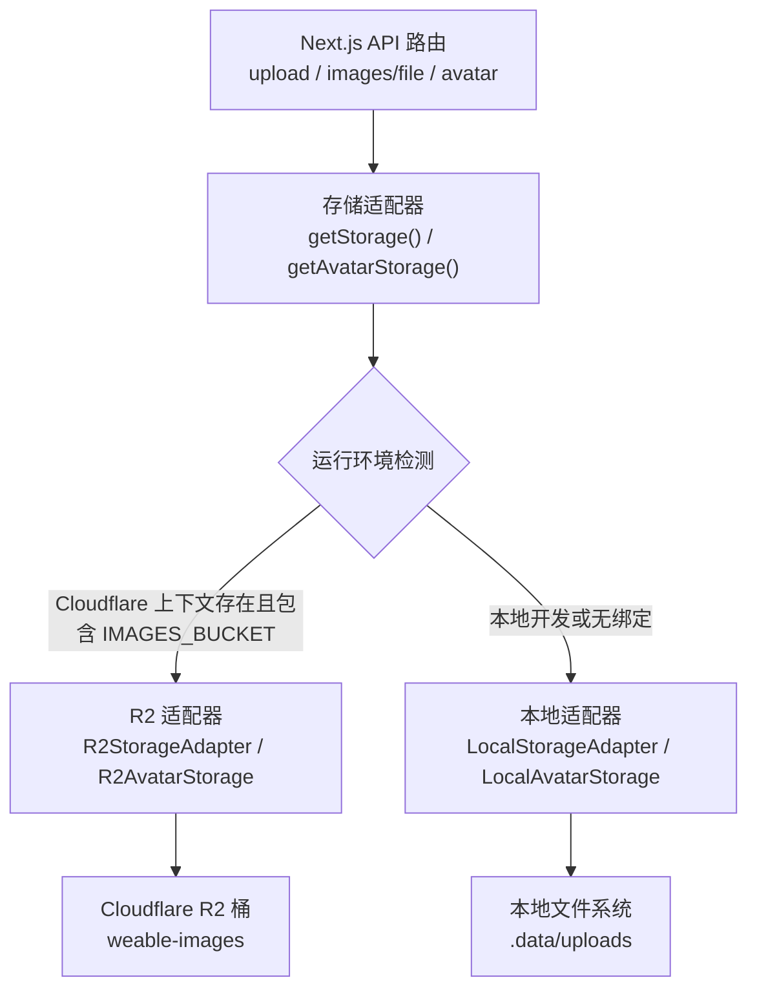
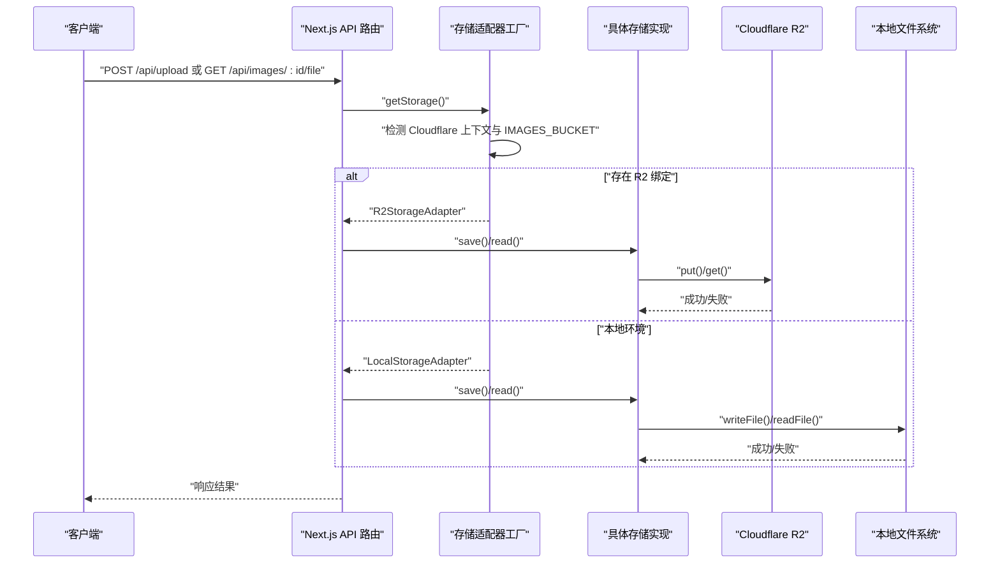
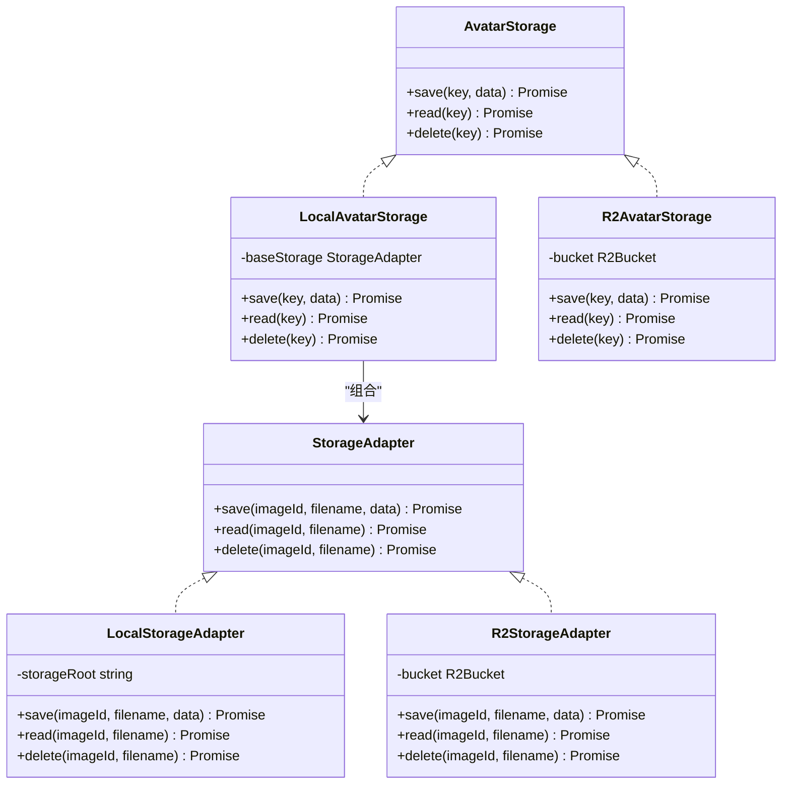
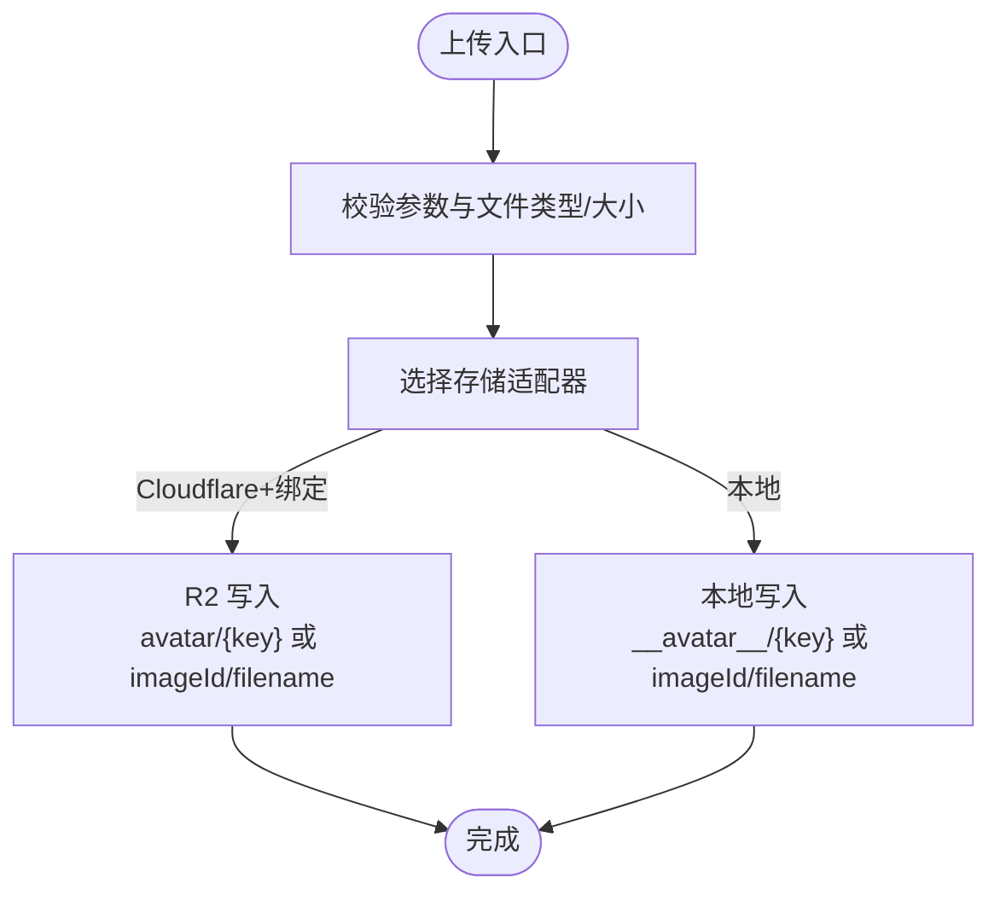
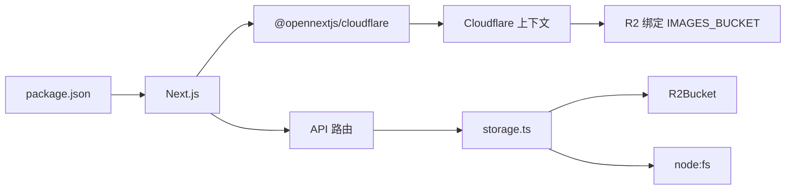

# 存储配置

<cite>
**本文引用的文件**   
- [wrangler.jsonc](file://wrangler.jsonc)
- [storage.ts](file://src/lib/storage.ts)
- [worker-configuration.d.ts](file://worker-configuration.d.ts)
- [upload/route.ts](file://src/app/api/upload/route.ts)
- [images/[imageId]/file/route.ts](file://src/app/api/images/[imageId]/file/route.ts)
- [user/avatar/route.ts](file://src/app/api/user/avatar/route.ts)
- [channel/avatar/[channelId]/route.ts](file://src/app/api/channel/avatar/[channelId]/route.ts)
- [package.json](file://package.json)
</cite>

## 目录
1. [简介](#简介)
2. [项目结构](#项目结构)
3. [核心组件](#核心组件)
4. [架构总览](#架构总览)
5. [详细组件分析](#详细组件分析)
6. [依赖关系分析](#依赖关系分析)
7. [性能与容量规划](#性能与容量规划)
8. [故障排查指南](#故障排查指南)
9. [结论](#结论)
10. [附录](#附录)

## 简介
本指南面向 Weable 应用的存储配置，重点说明：
- Cloudflare R2 存储桶的创建与权限配置
- wrangler.jsonc 中的存储桶绑定设置
- 存储适配器模式（本地文件系统与云端 R2）的实现与切换
- 头像与图片的分桶策略、访问控制与安全设置
- 存储路径规划、文件命名规范与性能优化建议
- 存储配额管理、成本优化与故障恢复最佳实践

## 项目结构
Weable 使用 Next.js API 路由处理上传与读取，通过统一的存储适配器在本地与 R2 之间无缝切换。R2 桶通过 wrangler.jsonc 绑定到运行时环境变量，供 storage.ts 自动发现并注入。

图表来源
- [storage.ts:184-213](file://src/lib/storage.ts#L184-L213)
- [wrangler.jsonc:23-32](file://wrangler.jsonc#L23-L32)

章节来源
- [wrangler.jsonc:1-34](file://wrangler.jsonc#L1-L34)
- [storage.ts:1-214](file://src/lib/storage.ts#L1-L214)

## 核心组件
- 存储适配器接口与实现
  - StorageAdapter：统一图片/文件的 save/read/delete 能力
  - AvatarStorage：头像专用的 save/read/delete 能力
  - LocalStorageAdapter / R2StorageAdapter：分别对接本地文件系统与 R2
  - LocalAvatarStorage / R2AvatarStorage：分别封装头像在本地与 R2 的路径前缀
- 运行时适配
  - getStorage()：根据运行环境返回图片存储适配器实例
  - getAvatarStorage()：根据运行环境返回头像存储适配器实例
- 安全校验
  - assertSafeSegment：防止路径穿越与非法字符
  - 键名生成：图片 key = imageId/filename；头像 key = avatar/{key} 或 __avatar__/{key}

章节来源
- [storage.ts:3-13](file://src/lib/storage.ts#L3-L13)
- [storage.ts:15-33](file://src/lib/storage.ts#L15-L33)
- [storage.ts:61-136](file://src/lib/storage.ts#L61-L136)
- [storage.ts:138-179](file://src/lib/storage.ts#L138-L179)
- [storage.ts:184-213](file://src/lib/storage.ts#L184-L213)

## 架构总览
下图展示了从 API 请求到存储读写的完整流程，以及本地与 R2 的自动切换逻辑。

图表来源
- [upload/route.ts:51-74](file://src/app/api/upload/route.ts#L51-L74)
- [images/[imageId]/file/route.ts:34-46](file://src/app/api/images/[imageId]/file/route.ts#L34-L46)
- [storage.ts:184-213](file://src/lib/storage.ts#L184-L213)

## 详细组件分析

### R2 存储桶创建与权限配置
- 创建步骤
  - 在 Cloudflare 控制台创建 R2 存储桶，名称建议为 weable-images
  - 如需公开访问，可开启“公共访问”或配置 CDN 规则；否则通过后端 API 鉴权后提供下载
- 权限建议
  - 最小权限原则：仅授予应用绑定的读写权限
  - 禁止直接暴露桶的公共列表接口，避免枚举风险
  - 结合 CDN/边缘缓存对静态资源做只读加速

章节来源
- [wrangler.jsonc:23-32](file://wrangler.jsonc#L23-L32)

### wrangler.jsonc 中的存储桶绑定设置
- 关键配置项
  - r2_buckets：定义 binding 名称与 bucket_name
  - 当前绑定：IMAGES_BUCKET -> weable-images
  - 可选：NEXT_INC_CACHE_R2_BUCKET（用于 Next 增量缓存，需保持该固定名称）
- 注意事项
  - 确保 binding 名称与代码中 getCloudflareContext().env.IMAGES_BUCKET 一致
  - 部署时 wrangler 会将绑定注入到运行时环境变量

章节来源
- [wrangler.jsonc:23-32](file://wrangler.jsonc#L23-L32)
- [worker-configuration.d.ts:32-35](file://worker-configuration.d.ts#L32-L35)

### 存储适配器模式的实现与切换
- 设计要点
  - 统一接口：StorageAdapter 与 AvatarStorage
  - 自动选择：getStorage()/getAvatarStorage() 依据运行环境决定实现
  - 安全校验：assertSafeSegment 防止路径穿越
- 本地与 R2 的差异
  - 本地：基于 node:fs/promises，根目录由 IMAGE_STORAGE_PATH 或默认 ./.data/uploads 决定
  - R2：基于 R2Bucket.put/get/delete，对象键按约定生成

图表来源
- [storage.ts:3-13](file://src/lib/storage.ts#L3-L13)
- [storage.ts:61-136](file://src/lib/storage.ts#L61-L136)
- [storage.ts:138-179](file://src/lib/storage.ts#L138-L179)

章节来源
- [storage.ts:184-213](file://src/lib/storage.ts#L184-L213)

### 头像存储与图片存储的分桶策略
- 分桶策略
  - 图片：统一使用 IMAGES_BUCKET（weable-images），对象键格式 imageId/filename
  - 头像：同样可使用同一桶，但采用独立前缀 avatar/{key}，便于隔离与审计
  - 本地开发：头像通过 LocalAvatarStorage 复用底层 StorageAdapter，内部以 __avatar__/key 区分
- 访问控制与安全
  - 头像读取接口支持 Cache-Control 缓存，提升性能
  - 上传接口限制 MIME 类型与大小，降低恶意载荷风险
  - 所有键段均经过安全校验，防止路径穿越

图表来源
- [user/avatar/route.ts:10-33](file://src/app/api/user/avatar/route.ts#L10-L33)
- [channel/avatar/[channelId]/route.ts:12-63](file://src/app/api/channel/avatar/[channelId]/route.ts#L12-L63)
- [storage.ts:155-179](file://src/lib/storage.ts#L155-L179)

章节来源
- [user/avatar/route.ts:1-34](file://src/app/api/user/avatar/route.ts#L1-L34)
- [channel/avatar/[channelId]/route.ts:1-64](file://src/app/api/channel/avatar/[channelId]/route.ts#L1-L64)
- [storage.ts:154-179](file://src/lib/storage.ts#L154-L179)

### 存储路径规划与文件命名规范
- 路径规划
  - 图片：imageId/filename（例如：a1b2c3d4/e.png）
  - 头像：avatar/key（例如：avatar/user_123 或 avatar/channel_456）
  - 本地：IMAGE_STORAGE_PATH 或默认 ./.data/uploads，子目录按 imageId 组织
- 命名规范
  - imageId：仅允许字母数字及下划线、短横线（由路由层校验）
  - filename：必须通过安全校验，不允许包含路径分隔符
  - 头像 key：由业务侧拼接 user_/channel_ 前缀，避免冲突

章节来源
- [images/[imageId]/file/route.ts:12-28](file://src/app/api/images/[imageId]/file/route.ts#L12-L28)
- [storage.ts:55-59](file://src/lib/storage.ts#L55-L59)
- [storage.ts:157-159](file://src/lib/storage.ts#L157-L159)

### 性能优化建议
- 缓存策略
  - 图片读取：Cache-Control: public, max-age=31536000, immutable（长期缓存）
  - 头像读取：Cache-Control: public, max-age=3600（短期缓存，便于更新）
- 传输优化
  - 前端上传前压缩与格式转换（如 WebP）
  - 合理分片上传大文件（后续可扩展）
- 存储优化
  - 使用对象键前缀进行分区，利于统计与清理
  - 定期归档冷数据至更低成本层级（若 R2 支持）

章节来源
- [images/[imageId]/file/route.ts:41-46](file://src/app/api/images/[imageId]/file/route.ts#L41-L46)
- [channel/avatar/[channelId]/route.ts:26-31](file://src/app/api/channel/avatar/[channelId]/route.ts#L26-L31)

## 依赖关系分析
- 运行时依赖
  - @opennextjs/cloudflare：用于获取 Cloudflare 上下文与环境变量
  - drizzle-orm：数据库操作（与存储无关，但影响整体流程）
  - better-sqlite3：本地开发数据库
- 构建与部署
  - next：框架
  - wrangler：Cloudflare Worker 部署工具
  - package.json 脚本：dev/build/start/db:migrate

图表来源
- [package.json:11-24](file://package.json#L11-L24)
- [storage.ts:1-2](file://src/lib/storage.ts#L1-L2)
- [worker-configuration.d.ts:32-35](file://worker-configuration.d.ts#L32-L35)

章节来源
- [package.json:1-40](file://package.json#L1-L40)
- [storage.ts:1-2](file://src/lib/storage.ts#L1-L2)
- [worker-configuration.d.ts:1-38](file://worker-configuration.d.ts#L1-L38)

## 性能与容量规划
- 容量规划
  - 预估月增文件大小与峰值并发，评估 R2 吞吐与带宽
  - 头像与图片分离前缀，便于单独监控与限流
- 配额管理
  - 设置应用级配额与告警（如单用户上传上限、每日总量）
  - 定期清理未关联文件或过期头像
- 成本优化
  - 启用 CDN 缓存静态资源
  - 使用更小的图片格式与尺寸
  - 将冷数据迁移到低频访问层（若可用）

[本节为通用指导，不直接分析具体文件]

## 故障排查指南
- 常见问题
  - R2 绑定未配置：在 Cloudflare 上下文检测到但未找到 IMAGES_BUCKET 会抛出错误
  - 本地路径不存在：Local 模式下需确保 IMAGE_STORAGE_PATH 指向有效目录
  - 文件类型/大小限制：上传接口会拒绝不符合要求的文件
- 定位方法
  - 检查 wrangler.jsonc 的 r2_buckets 绑定是否正确
  - 查看 API 路由的错误返回码与消息
  - 本地开发时确认 ./.data/uploads 目录权限与空间

章节来源
- [storage.ts:190-196](file://src/lib/storage.ts#L190-L196)
- [storage.ts:204-210](file://src/lib/storage.ts#L204-L210)
- [user/avatar/route.ts:20-26](file://src/app/api/user/avatar/route.ts#L20-L26)
- [channel/avatar/[channelId]/route.ts:50-56](file://src/app/api/channel/avatar/[channelId]/route.ts#L50-L56)

## 结论
通过统一的存储适配器与运行时环境检测，Weable 能够在本地开发与生产环境中无缝切换存储后端。配合合理的分桶策略、路径规划与安全校验，既能保证性能与安全性，又便于扩展与维护。建议在生产环境优先使用 R2，并结合 CDN 与缓存策略优化用户体验与成本。

[本节为总结性内容，不直接分析具体文件]

## 附录
- 环境变量与配置
  - IMAGE_STORAGE_PATH：本地存储根目录（可选）
  - DB_PATH：本地 SQLite 数据库路径（与存储无关）
- 相关脚本
  - dev/build/start：Next.js 生命周期
  - db:migrate：数据库迁移

章节来源
- [storage.ts:63](file://src/lib/storage.ts#L63)
- [package.json:5-9](file://package.json#L5-L9)