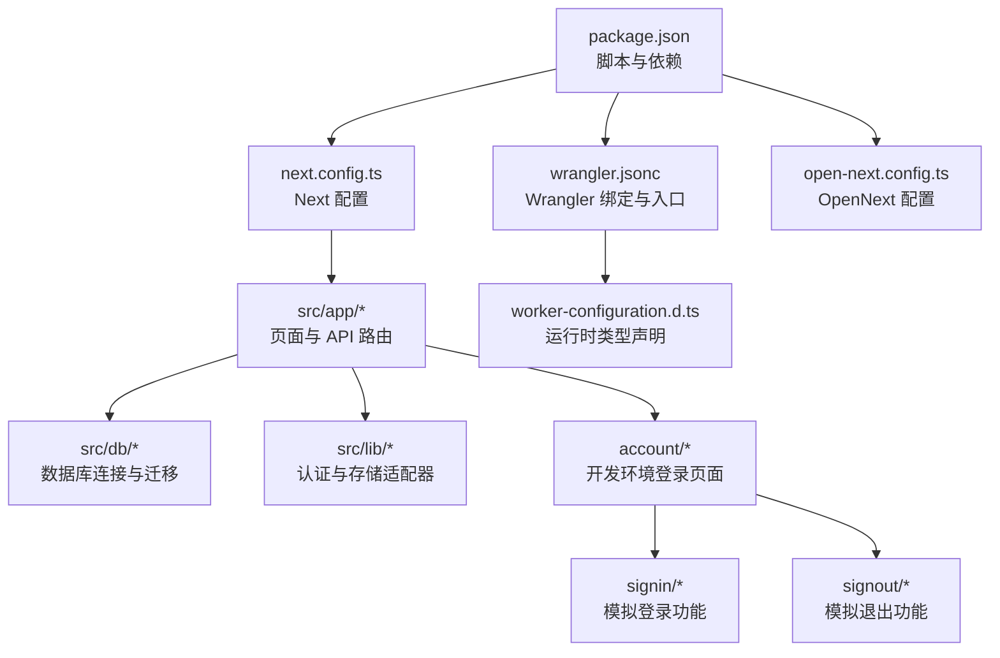
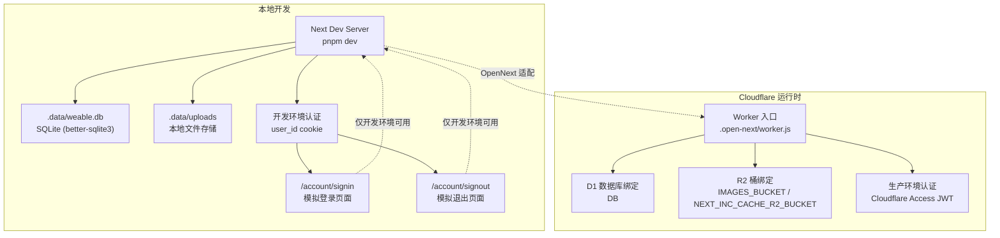
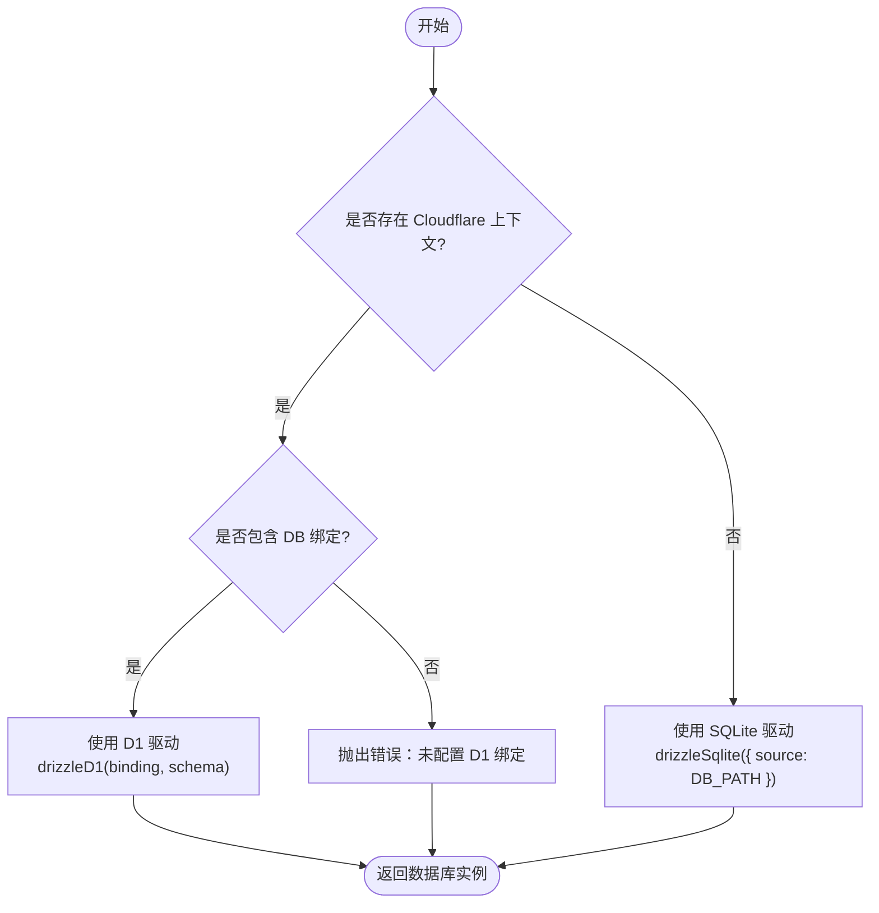
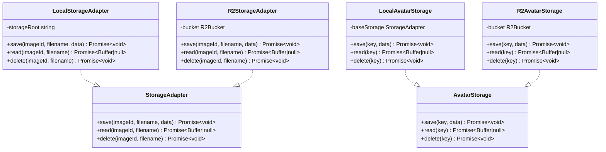
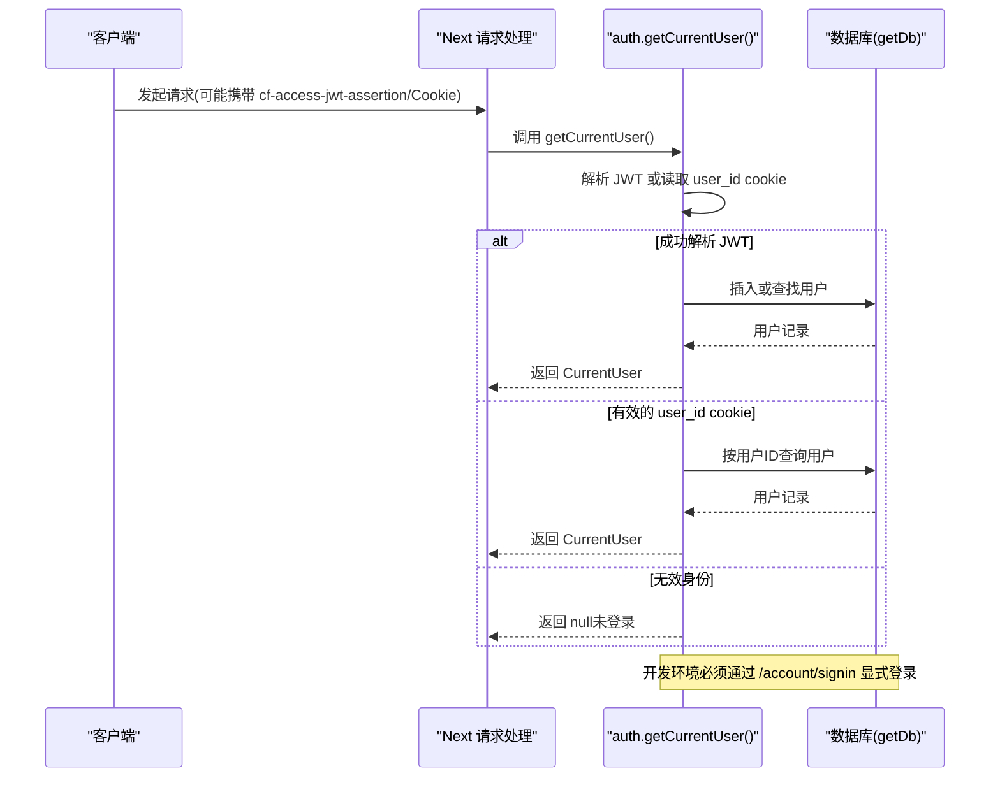
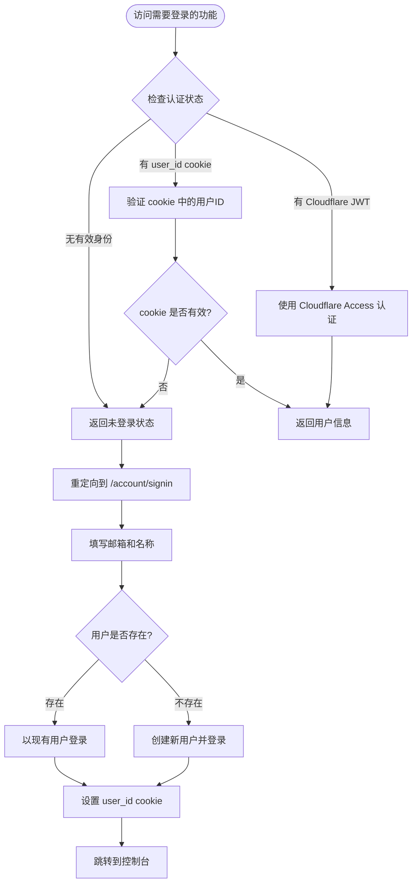
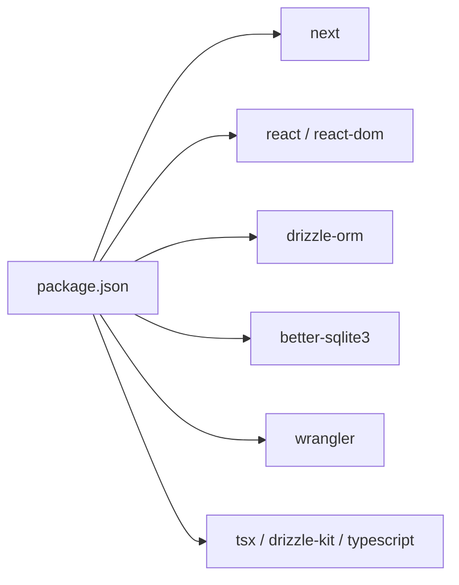

# 开发环境搭建

<cite>
**本文引用的文件**   
- [package.json](file://package.json)
- [wrangler.jsonc](file://wrangler.jsonc)
- [drizzle.config.ts](file://drizzle.config.ts)
- [next.config.ts](file://next.config.ts)
- [open-next.config.ts](file://open-next.config.ts)
- [src/db/index.ts](file://src/db/index.ts)
- [src/db/migrate.ts](file://src/db/migrate.ts)
- [src/lib/auth.ts](file://src/lib/auth.ts)
- [src/lib/storage.ts](file://src/lib/storage.ts)
- [worker-configuration.d.ts](file://worker-configuration.d.ts)
- [src/app/[lang]/account/signin/page.tsx](file://src/app/[lang]/account/signin/page.tsx)
- [src/app/[lang]/account/signin/actions.ts](file://src/app/[lang]/account/signin/actions.ts)
- [src/app/[lang]/account/signin/sign-in-form.tsx](file://src/app/[lang]/account/signin/sign-in-form.tsx)
- [src/app/[lang]/account/signout/page.tsx](file://src/app/[lang]/account/signout/page.tsx)
- [src/app/[lang]/account/signout/actions.ts](file://src/app/[lang]/account/signout/actions.ts)
</cite>

## 更新摘要
**所做更改**
- 新增开发环境模拟登录系统的详细说明
- 更新认证流程以反映取消自动回退 dev 账号的变更
- 添加 account/signin 和 account/signout 页面的使用指南
- 强调生产环境中这些页面的安全限制
- 更新本地开发服务器启动步骤以包含数据库迁移要求

## 目录
1. [简介](#简介)
2. [项目结构](#项目结构)
3. [核心组件](#核心组件)
4. [架构总览](#架构总览)
5. [详细组件分析](#详细组件分析)
6. [依赖分析](#依赖分析)
7. [性能考虑](#性能考虑)
8. [故障排查指南](#故障排查指南)
9. [结论](#结论)
10. [附录](#附录)

## 简介
本指南面向首次接触 Weable 的开发者，提供从零到一的本地开发环境搭建说明。内容涵盖：
- Node.js 与 pnpm 的安装要求
- 项目依赖初始化与构建脚本
- 本地开发服务器启动步骤
- **新增**：开发环境模拟登录系统的配置与使用
- 数据库连接配置（D1 本地模拟与 SQLite）
- 环境变量配置示例（Cloudflare Access JWT、R2 存储凭据等）
- 调试技巧、热重载配置与常见问题解决方案

Weable 是一个基于 Next.js 的图片管理应用，通过 @opennextjs/cloudflare 适配部署到 Cloudflare Workers，并在本地使用 SQLite 进行数据持久化，在云端使用 D1 和 R2。**重要更新**：开发环境现已支持通过专门的登录页面进行用户身份验证，不再自动回退到开发用户。

## 项目结构
仓库采用 Next.js App Router 组织页面与 API 路由，数据库与 ORM 使用 Drizzle ORM，运行时绑定由 Wrangler 管理，OpenNext 负责将 Next 应用适配为 Cloudflare Worker。

图表来源
- [package.json:1-40](file://package.json#L1-L40)
- [next.config.ts:1-15](file://next.config.ts#L1-L15)
- [wrangler.jsonc:1-34](file://wrangler.jsonc#L1-L34)
- [open-next.config.ts:1-10](file://open-next.config.ts#L1-L10)
- [worker-configuration.d.ts:1-39](file://worker-configuration.d.ts#L1-L39)
- [src/app/[lang]/account/signin/page.tsx:1-33](file://src/app/[lang]/account/signin/page.tsx#L1-L33)
- [src/app/[lang]/account/signout/page.tsx:1-59](file://src/app/[lang]/account/signout/page.tsx#L1-L59)

章节来源
- [package.json:1-40](file://package.json#L1-L40)
- [next.config.ts:1-15](file://next.config.ts#L1-L15)
- [wrangler.jsonc:1-34](file://wrangler.jsonc#L1-L34)
- [open-next.config.ts:1-10](file://open-next.config.ts#L1-L10)

## 核心组件
- 包管理与脚本：定义 dev/build/start/db:migrate 等命令，指定 pnpm 版本与关键依赖。
- Next.js 配置：启用严格模式、允许的开发源、页面扩展名等。
- OpenNext 配置：用于 Cloudflare 适配，可开启 R2 增量缓存。
- Wrangler 配置：定义 Worker 入口、D1 数据库绑定、R2 桶绑定与资产目录。
- 数据库层：Drizzle ORM + better-sqlite3（本地），D1（云端）。
- **更新**：认证模块：解析 Cloudflare Access JWT，或回退到通过 user_id cookie 标识的开发环境模拟登录用户。
- 存储适配器：本地文件系统与 R2 对象存储的统一接口。
- **新增**：开发环境模拟登录系统：提供专门的 signin/signout 页面用于本地开发验证。

章节来源
- [package.json:1-40](file://package.json#L1-L40)
- [next.config.ts:1-15](file://next.config.ts#L1-L15)
- [open-next.config.ts:1-10](file://open-next.config.ts#L1-L10)
- [wrangler.jsonc:1-34](file://wrangler.jsonc#L1-L34)
- [src/db/index.ts:1-61](file://src/db/index.ts#L1-L61)
- [src/lib/auth.ts:1-125](file://src/lib/auth.ts#L1-L125)
- [src/lib/storage.ts:1-214](file://src/lib/storage.ts#L1-L214)
- [src/app/[lang]/account/signin/actions.ts:1-51](file://src/app/[lang]/account/signin/actions.ts#L1-L51)
- [src/app/[lang]/account/signout/actions.ts:1-13](file://src/app/[lang]/account/signout/actions.ts#L1-L13)

## 架构总览
下图展示了本地开发与云端运行时的关键路径：开发时优先使用 SQLite；在 Cloudflare 环境中自动切换到 D1 与 R2。**更新**：开发环境现在需要通过专门的登录页面进行身份验证。

图表来源
- [package.json:1-40](file://package.json#L1-L40)
- [wrangler.jsonc:1-34](file://wrangler.jsonc#L1-L34)
- [src/db/index.ts:1-61](file://src/db/index.ts#L1-L61)
- [src/lib/storage.ts:1-214](file://src/lib/storage.ts#L1-L214)
- [src/app/[lang]/account/signin/page.tsx:1-33](file://src/app/[lang]/account/signin/page.tsx#L1-L33)
- [src/app/[lang]/account/signout/page.tsx:1-59](file://src/app/[lang]/account/signout/page.tsx#L1-L59)
- [src/lib/auth.ts:1-125](file://src/lib/auth.ts#L1-L125)

## 详细组件分析

### 环境与工具安装
- Node.js：建议使用 LTS 版本（与 pnpm@10.x 兼容）。
- pnpm：项目锁定版本为 pnpm@10.33.0+sha512...，推荐使用 nvm 或 corepack 管理 Node/pnpm。
- 安装依赖：在项目根目录执行 pnpm install。
- 构建与启动：
  - 开发：pnpm dev（默认端口 7600，启用 Turbo 模式）
  - 构建：pnpm build
  - 生产启动：pnpm start

章节来源
- [package.json:1-40](file://package.json#L1-L40)

### 数据库配置与迁移
- 本地数据库：
  - 驱动：better-sqlite3
  - 文件路径：通过环境变量 DB_PATH 控制，默认位于 ./.data/weable.db
  - 自动创建目录：若目录不存在则递归创建
- 云端数据库：
  - 驱动：D1（通过 @opennextjs/cloudflare 上下文获取绑定）
  - 绑定名称：DB（在 wrangler.jsonc 中声明）
- 迁移：
  - 使用 drizzle-kit，方言 sqlite
  - 迁移脚本位置：./migrations
  - 执行命令：pnpm db:migrate（调用 tsx src/db/migrate.ts）

图表来源
- [src/db/index.ts:1-61](file://src/db/index.ts#L1-L61)
- [drizzle.config.ts:1-8](file://drizzle.config.ts#L1-L8)
- [src/db/migrate.ts:1-24](file://src/db/migrate.ts#L1-L24)

章节来源
- [src/db/index.ts:1-61](file://src/db/index.ts#L1-L61)
- [drizzle.config.ts:1-8](file://drizzle.config.ts#L1-L8)
- [src/db/migrate.ts:1-24](file://src/db/migrate.ts#L1-L24)

### 存储适配器（图片与头像）
- 统一接口：StorageAdapter（图片）、AvatarStorage（头像）
- 本地实现：LocalStorageAdapter、LocalAvatarStorage（基于文件系统）
- 云端实现：R2StorageAdapter、R2AvatarStorage（基于 R2 桶）
- 选择逻辑：
  - 若存在 Cloudflare 上下文且 IMAGES_BUCKET 绑定可用，则使用 R2
  - 否则在本地使用文件系统存储
  - 若处于 Cloudflare 上下文但未配置绑定，则抛出错误提示检查 wrangler.jsonc

图表来源
- [src/lib/storage.ts:1-214](file://src/lib/storage.ts#L1-L214)
- [worker-configuration.d.ts:1-39](file://worker-configuration.d.ts#L1-L39)

章节来源
- [src/lib/storage.ts:1-214](file://src/lib/storage.ts#L1-L214)
- [worker-configuration.d.ts:1-39](file://worker-configuration.d.ts#L1-L39)

### 认证流程（更新：支持开发环境模拟登录）
**重大更新**：认证流程已更新以支持开发环境模拟登录系统，并移除了自动回退到开发用户的逻辑。

- 支持从请求头或 Cookie 中读取 Cloudflare Access 的 JWT（cf-access-jwt-assertion、CF_Authorization、cf_authorization）
- 解析 JWT payload 提取用户标识（sub、email、name/preferred_username/common_name）
- **新增**：开发环境模拟登录会话：通过 user_id cookie 承载，值为 users.id，按 ID 查库还原真实身份
- **移除**：不再自动回退到 DEV_USER_* 环境变量定义的"开发用户"
- 若未携带有效 JWT 且无有效的 user_id cookie：
  - 返回 null（表示未登录），不再自动赋予开发用户身份
- 用户信息写入 users 表并返回当前用户

图表来源
- [src/lib/auth.ts:1-125](file://src/lib/auth.ts#L1-L125)
- [src/db/index.ts:1-61](file://src/db/index.ts#L1-L61)
- [src/app/[lang]/account/signin/actions.ts:1-51](file://src/app/[lang]/account/signin/actions.ts#L1-L51)

章节来源
- [src/lib/auth.ts:1-125](file://src/lib/auth.ts#L1-L125)

### 开发环境模拟登录系统（新增）
**新功能**：Weable 现在提供了专门的开发环境模拟登录系统，用于本地开发验证。

#### 登录页面（/account/signin）
- **访问方式**：`http://localhost:7600/{语言}/account/signin`
- **功能**：输入邮箱（必填）和用户名称（可选）进行登录
- **行为**：
  - 邮箱格式校验：非空且包含 "@" 符号
  - 查找现有用户：按邮箱匹配已有用户
  - 创建新用户：若邮箱不存在则自动创建新用户
  - 设置会话：写入 user_id cookie 并跳转到控制台
  - 身份切换：覆盖之前的登录状态

#### 退出页面（/account/signout）
- **访问方式**：`http://localhost:7600/{语言}/account/signout`
- **功能**：显示当前登录用户信息并提供退出按钮
- **行为**：
  - 已登录：显示用户名称和邮箱，提供退出按钮
  - 未登录：显示"当前未登录"提示和前往登录页的链接
  - 退出操作：删除 user_id cookie 并跳转回登录页

#### 安全限制
- **仅开发环境可用**：在生产环境中访问这些页面会返回 404
- **强制显式登录**：开发环境不再自动回退到开发用户，必须通过登录页面进行身份验证

图表来源
- [src/app/[lang]/account/signin/page.tsx:1-33](file://src/app/[lang]/account/signin/page.tsx#L1-L33)
- [src/app/[lang]/account/signin/actions.ts:1-51](file://src/app/[lang]/account/signin/actions.ts#L1-L51)
- [src/app/[lang]/account/signout/page.tsx:1-59](file://src/app/[lang]/account/signout/page.tsx#L1-L59)
- [src/app/[lang]/account/signout/actions.ts:1-13](file://src/app/[lang]/account/signout/actions.ts#L1-L13)
- [src/lib/auth.ts:1-125](file://src/lib/auth.ts#L1-L125)

章节来源
- [src/app/[lang]/account/signin/page.tsx:1-33](file://src/app/[lang]/account/signin/page.tsx#L1-L33)
- [src/app/[lang]/account/signin/actions.ts:1-51](file://src/app/[lang]/account/signin/actions.ts#L1-L51)
- [src/app/[lang]/account/signin/sign-in-form.tsx:1-56](file://src/app/[lang]/account/signin/sign-in-form.tsx#L1-L56)
- [src/app/[lang]/account/signout/page.tsx:1-59](file://src/app/[lang]/account/signout/page.tsx#L1-L59)
- [src/app/[lang]/account/signout/actions.ts:1-13](file://src/app/[lang]/account/signout/actions.ts#L1-L13)
- [src/lib/auth.ts:1-125](file://src/lib/auth.ts#L1-L125)

### OpenNext 与 Cloudflare 适配
- 入口：.open-next/worker.js（由 open-next 生成）
- 配置：open-next.config.ts 中可通过 r2IncrementalCache 启用 R2 增量缓存
- 运行时类型：worker-configuration.d.ts 定义了 D1/R2/CloudflareEnv 等类型

章节来源
- [open-next.config.ts:1-10](file://open-next.config.ts#L1-L10)
- [worker-configuration.d.ts:1-39](file://worker-configuration.d.ts#L1-L39)

## 依赖分析
- 运行时依赖：Next、React、Drizzle ORM、better-sqlite3、bs58、uuidv7 等
- 开发依赖：tsx、drizzle-kit、wrangler、TailwindCSS、TypeScript 等
- 关键脚本：dev/build/start/db:migrate

图表来源
- [package.json:1-40](file://package.json#L1-L40)

章节来源
- [package.json:1-40](file://package.json#L1-L40)

## 性能考虑
- 开发模式：pnpm dev 使用 --turbo 提升编译与热更新速度
- 增量缓存：可在 open-next.config.ts 中启用 R2 作为增量缓存后端，减少冷启动与重复渲染开销
- 数据库：本地 SQLite 适合快速迭代；云端 D1 具备低延迟与高并发特性
- 存储：大文件上传建议结合 CDN 与分片策略（后续可扩展）
- **新增**：开发环境模拟登录减少了手动配置认证的时间成本

[本节为通用指导，不直接分析具体文件]

## 故障排查指南
- 无法找到数据库绑定（D1）：
  - 现象：在 Cloudflare 上下文中运行时报错提示未配置 D1 绑定
  - 解决：检查 wrangler.jsonc 中的 d1_databases 配置是否正确
- 无法找到 R2 桶绑定：
  - 现象：在 Cloudflare 上下文中运行时报错提示未配置 IMAGES_BUCKET
  - 解决：检查 wrangler.jsonc 中的 r2_buckets 配置，确保 binding 名称一致
- 本地文件路径问题：
  - 现象：读写图片失败或目录不存在
  - 解决：确认 IMAGE_STORAGE_PATH 指向有效目录，或保持默认 ./.data/uploads
- 迁移失败：
  - 现象：db:migrate 报错或迁移未生效
  - 解决：检查 migrations 目录与 drizzle.config.ts 的 dialect/out/schema 设置
- **新增**：开发环境无法登录：
  - 现象：访问控制台页面被拒绝，提示未登录
  - 解决：访问 `http://localhost:7600/{语言}/account/signin` 进行登录
- **新增**：生产环境无法访问登录页面：
  - 现象：访问 /account/signin 或 /account/signout 返回 404
  - 解决：这是预期行为，生产环境应使用 Cloudflare Access 进行认证
- 认证失败（生产环境）：
  - 现象：未携带有效 JWT 或 Cookie 时抛出错误
  - 解决：确保 Cloudflare Access 已正确配置并下发 JWT

章节来源
- [src/db/index.ts:1-61](file://src/db/index.ts#L1-L61)
- [src/lib/storage.ts:1-214](file://src/lib/storage.ts#L1-L214)
- [src/lib/auth.ts:1-125](file://src/lib/auth.ts#L1-L125)
- [src/app/[lang]/account/signin/page.tsx:1-33](file://src/app/[lang]/account/signin/page.tsx#L1-L33)
- [src/app/[lang]/account/signout/page.tsx:1-59](file://src/app/[lang]/account/signout/page.tsx#L1-L59)
- [wrangler.jsonc:1-34](file://wrangler.jsonc#L1-L34)
- [drizzle.config.ts:1-8](file://drizzle.config.ts#L1-L8)

## 结论
通过以上步骤，你可以在本地快速搭建 Weable 的开发环境，并使用 SQLite 进行数据持久化与本地文件存储。**重要更新**：开发环境现已支持通过专门的登录页面进行用户身份验证，不再自动回退到开发用户。部署到 Cloudflare 后，应用会自动切换至 D1 与 R2，并获得更好的性能与可扩展性。建议在开发阶段充分验证迁移与存储路径，在生产环境确保所有绑定与密钥配置完整。

[本节为总结，不直接分析具体文件]

## 附录

### 环境变量参考
- 数据库
  - DB_PATH：本地 SQLite 文件路径，默认 ./.data/weable.db
- 存储
  - IMAGE_STORAGE_PATH：本地图片存储根目录，默认 ./.data/uploads
- **更新**：认证（开发）
  - **移除**：DEV_USER_ID、DEV_USER_NAME、DEV_USER_EMAIL（不再使用）
  - **新增**：user_id cookie（开发环境模拟登录会话）
- 其他
  - NODE_ENV：区分开发与生产环境
  - CF_ACCESS_JWT_ASSERTION：Cloudflare Access 下发的 JWT（通常由框架注入）
  - CF_Authorization / cf_authorization：Cookie 中的授权令牌

章节来源
- [src/db/index.ts:1-61](file://src/db/index.ts#L1-L61)
- [src/db/migrate.ts:1-24](file://src/db/migrate.ts#L1-L24)
- [src/lib/auth.ts:1-125](file://src/lib/auth.ts#L1-L125)
- [src/lib/storage.ts:1-214](file://src/lib/storage.ts#L1-L214)

### 本地开发服务器启动步骤（更新）
- 安装依赖：pnpm install
- 初始化数据库：pnpm db:migrate
- 启动开发服务：pnpm dev（访问 http://127.0.0.1:7600）
- **新增**：开发环境登录：访问 `http://localhost:7600/{语言}/account/signin` 进行登录
- **新增**：开发环境退出：访问 `http://localhost:7600/{语言}/account/signout` 进行退出
- 构建与生产启动：pnpm build && pnpm start

章节来源
- [package.json:1-40](file://package.json#L1-L40)
- [next.config.ts:1-15](file://next.config.ts#L1-L15)
- [src/app/[lang]/account/signin/page.tsx:1-33](file://src/app/[lang]/account/signin/page.tsx#L1-L33)
- [src/app/[lang]/account/signout/page.tsx:1-59](file://src/app/[lang]/account/signout/page.tsx#L1-L59)

### 调试技巧与热重载（更新）
- 使用 pnpm dev 的 Turbo 模式加速热更新
- 在浏览器开发者工具中查看请求头与 Cookie，确认 cf-access-jwt-assertion 或 CF_Authorization 是否传递
- **新增**：开发环境调试：
  - 检查 user_id cookie 是否存在于浏览器开发者工具的 Application > Cookies 中
  - 访问 `/account/signin` 页面进行登录验证
  - 访问 `/account/signout` 页面进行退出验证
- 使用 console.log 或日志系统观察 getDb/getStorage 的选择分支
- 在 Cloudflare 本地调试可使用 wrangler dev（需确保绑定配置正确）

章节来源
- [package.json:1-40](file://package.json#L1-L40)
- [src/lib/auth.ts:1-125](file://src/lib/auth.ts#L1-L125)
- [src/lib/storage.ts:1-214](file://src/lib/storage.ts#L1-L214)
- [src/app/[lang]/account/signin/actions.ts:1-51](file://src/app/[lang]/account/signin/actions.ts#L1-L51)
- [src/app/[lang]/account/signout/actions.ts:1-13](file://src/app/[lang]/account/signout/actions.ts#L1-L13)

### 开发环境模拟登录使用指南（新增）
#### 基本使用流程
1. 启动开发服务器：`pnpm dev`
2. 访问登录页面：`http://localhost:7600/zh/account/signin`
3. 输入邮箱（必填）和用户名称（可选）
4. 点击登录按钮，系统将自动跳转到控制台

#### 常用场景
- **新用户登录**：输入全新邮箱，系统将自动创建新用户
- **已有用户登录**：输入已有邮箱，将以该用户身份登录
- **身份切换**：已登录状态下再次登录，将切换到新用户身份
- **退出登录**：访问 `/account/signout` 并点击退出按钮

#### 注意事项
- **仅开发环境可用**：生产环境访问这些页面将返回 404
- **强制显式登录**：开发环境不再自动回退到开发用户
- **邮箱格式校验**：必须包含 "@" 符号才能提交
- **多语言支持**：所有受支持的语言前缀下行为一致

章节来源
- [specs/005-dev-signin-signout/spec.md:1-110](file://specs/005-dev-signin-signout/spec.md#L1-L110)
- [specs/005-dev-signin-signout/quickstart.md:1-67](file://specs/005-dev-signin-signout/quickstart.md#L1-L67)
- [specs/005-dev-signin-signout/contracts/account-pages.md:1-54](file://specs/005-dev-signin-signout/contracts/account-pages.md#L1-L54)