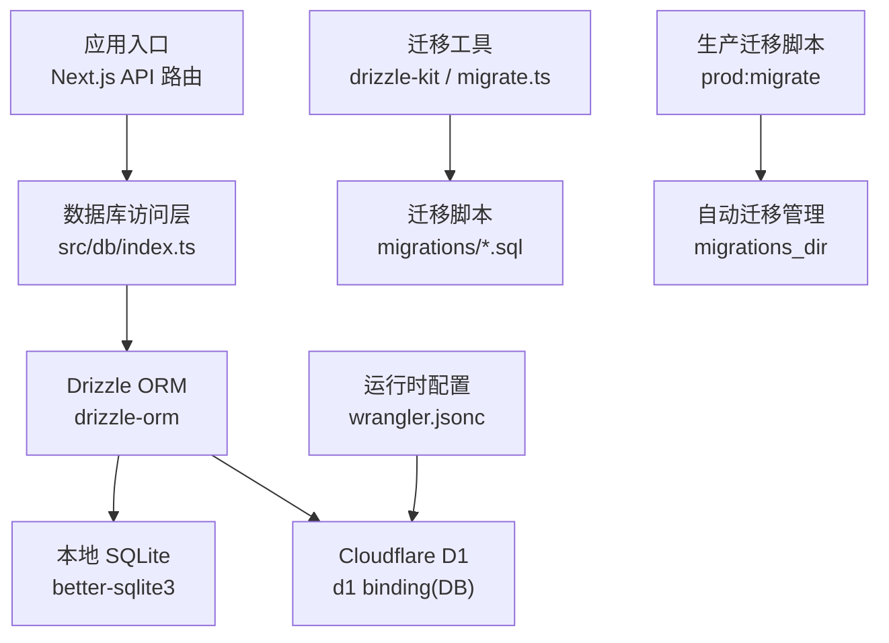
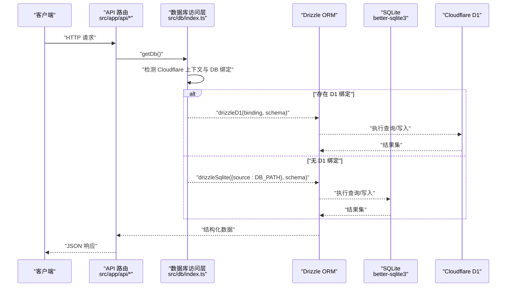
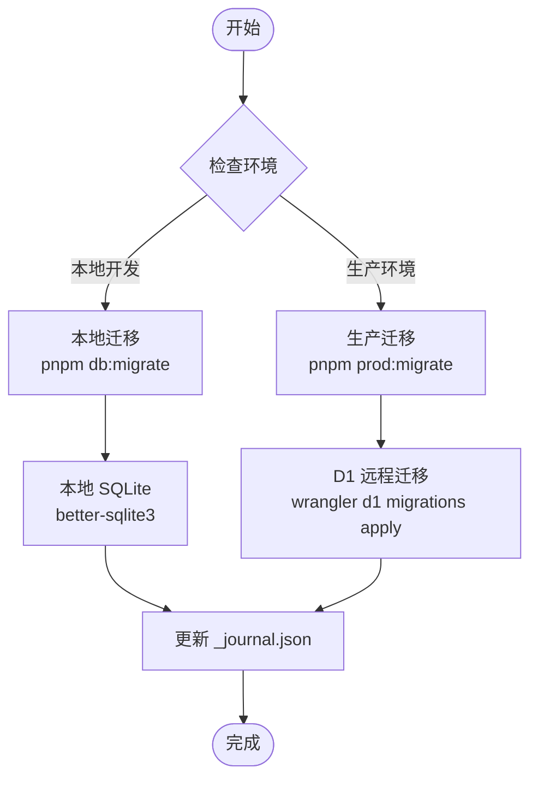
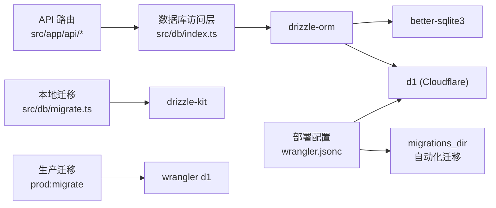
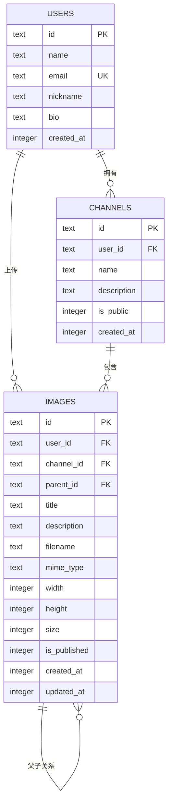

# 数据库配置

<cite>
**本文引用的文件**   
- [wrangler.jsonc](file://wrangler.jsonc)
- [drizzle.config.ts](file://drizzle.config.ts)
- [src/db/index.ts](file://src/db/index.ts)
- [src/db/schema.ts](file://src/db/schema.ts)
- [src/db/migrate.ts](file://src/db/migrate.ts)
- [migrations/meta/_journal.json](file://migrations/meta/_journal.json)
- [migrations/0000_cynical_mordo.sql](file://migrations/0000_cynical_mordo.sql)
- [migrations/0001_happy_the_phantom.sql](file://migrations/0001_happy_the_phantom.sql)
- [migrations/0002_gorgeous_storm.sql](file://migrations/0002_gorgeous_storm.sql)
- [package.json](file://package.json)
- [worker-configuration.d.ts](file://worker-configuration.d.ts)
- [src/app/api/images/route.ts](file://src/app/api/images/route.ts)
- [src/app/api/channels/[channelId]/route.ts](file://src/app/api/channels/[channelId]/route.ts)
</cite>

## 更新摘要
**所做更改**
- 更新了 wrangler.jsonc 中的 D1 数据库配置，新增 migrations_dir 设置用于自动化迁移管理
- 新增了 prod:migrate 脚本用于生产环境迁移执行
- 更新了部署流程说明，包含新的迁移工作流
- 完善了本地开发和生产环境的迁移策略对比

## 目录
1. [简介](#简介)
2. [项目结构](#项目结构)
3. [核心组件](#核心组件)
4. [架构总览](#架构总览)
5. [详细组件分析](#详细组件分析)
6. [依赖分析](#依赖分析)
7. [性能考虑](#性能考虑)
8. [故障排查指南](#故障排查指南)
9. [结论](#结论)
10. [附录](#附录)

## 简介
本指南面向 Weable 应用的数据库配置与运维，覆盖以下内容：
- Cloudflare D1 数据库的创建与连接绑定（wrangler.jsonc）
- Drizzle ORM 的配置、Schema 定义与迁移管理
- 本地开发 SQLite 与生产环境 D1 的连接切换策略
- 数据库初始化步骤（表结构、索引、迁移执行）
- 备份、恢复与性能监控的最佳实践

## 项目结构
Weable 使用 Next.js App Router + OpenNext + Cloudflare Worker 部署。数据库相关代码集中在 src/db 目录，迁移脚本位于 migrations 目录，运行时绑定在 wrangler.jsonc 中声明。

图表来源
- [src/db/index.ts:1-61](file://src/db/index.ts#L1-L61)
- [drizzle.config.ts:1-8](file://drizzle.config.ts#L1-L8)
- [wrangler.jsonc:16-24](file://wrangler.jsonc#L16-L24)
- [src/db/migrate.ts:1-24](file://src/db/migrate.ts#L1-L24)
- [migrations/0000_cynical_mordo.sql:1-38](file://migrations/0000_cynical_mordo.sql#L1-L38)
- [package.json:12-14](file://package.json#L12-L14)

章节来源
- [wrangler.jsonc:1-41](file://wrangler.jsonc#L1-L41)
- [drizzle.config.ts:1-8](file://drizzle.config.ts#L1-L8)
- [src/db/index.ts:1-61](file://src/db/index.ts#L1-L61)
- [src/db/migrate.ts:1-24](file://src/db/migrate.ts#L1-L24)
- [migrations/meta/_journal.json:1-27](file://migrations/meta/_journal.json#L1-L27)

## 核心组件
- 数据库连接与运行环境选择
  - 通过 getDb() 自动判断当前是否在 Cloudflare 上下文，若存在 DB 绑定则返回 D1 实例，否则回退到本地 SQLite。
  - 本地 SQLite 路径由环境变量 DB_PATH 控制，默认位于 ./.data/weable.db，并自动确保目录存在。
- Schema 定义
  - 使用 Drizzle 的 sqliteTable 定义 users、channels、images 三张表及其关系。
  - 提供 createId() 生成基于 uuidv7 的 Base58 ID，保证短且有序。
- 迁移管理
  - drizzle.config.ts 指定 schema 位置、输出目录与方言。
  - src/db/migrate.ts 用于本地执行迁移，读取 ./migrations 下的 SQL 文件。
  - **新增** wrangler.jsonc 中配置 migrations_dir 实现自动化迁移管理。
- 运行时绑定
  - wrangler.jsonc 中 d1_databases 数组声明了 DB 绑定的名称、数据库名、ID 与迁移目录。
  - worker-configuration.d.ts 为全局类型提供 D1Database 等接口。

章节来源
- [src/db/index.ts:1-61](file://src/db/index.ts#L1-L61)
- [src/db/schema.ts:1-101](file://src/db/schema.ts#L1-L101)
- [drizzle.config.ts:1-8](file://drizzle.config.ts#L1-L8)
- [src/db/migrate.ts:1-24](file://src/db/migrate.ts#L1-L24)
- [wrangler.jsonc:16-24](file://wrangler.jsonc#L16-L24)
- [worker-configuration.d.ts:1-39](file://worker-configuration.d.ts#L1-L39)

## 架构总览
下图展示了请求从 API 路由进入后，如何根据运行环境选择 D1 或 SQLite，并通过 Drizzle ORM 访问数据。

图表来源
- [src/app/api/images/route.ts:1-66](file://src/app/api/images/route.ts#L1-L66)
- [src/app/api/channels/[channelId]/route.ts:1-44](file://src/app/api/channels/[channelId]/route.ts#L1-L44)
- [src/db/index.ts:1-61](file://src/db/index.ts#L1-L61)

## 详细组件分析

### D1 数据库创建与连接配置（wrangler.jsonc）
- 在 wrangler.jsonc 的 d1_databases 数组中声明绑定：
  - binding: 绑定名称（如 DB），应用通过 env.DB 获取
  - database_name: 数据库逻辑名称（如 weable-db）
  - database_id: 实际 D1 数据库实例 ID
  - **新增** migrations_dir: 迁移脚本目录路径（./migrations），用于自动化迁移管理
- 部署时，OpenNext 会将 Next.js 应用打包为 Worker，并在运行时注入 DB 绑定。

**更新** 新增了 migrations_dir 配置，实现了 D1 数据库的自动化迁移管理功能。

章节来源
- [wrangler.jsonc:16-24](file://wrangler.jsonc#L16-L24)
- [worker-configuration.d.ts:32-35](file://worker-configuration.d.ts#L32-L35)

### Drizzle ORM 配置与 Schema 定义
- drizzle.config.ts
  - schema: 指向 src/db/schema.ts
  - out: 迁移输出目录 ./migrations
  - dialect: sqlite（与 D1 兼容）
- schema.ts
  - 定义 users、channels、images 表结构与关系
  - 提供 createId() 生成 Base58 格式的 UUIDv7 主键
  - 字段包含时间戳、布尔值、外键约束等

章节来源
- [drizzle.config.ts:1-8](file://drizzle.config.ts#L1-L8)
- [src/db/schema.ts:1-101](file://src/db/schema.ts#L1-L101)

### 迁移脚本管理与执行流程
- 迁移元数据
  - migrations/meta/_journal.json 记录已执行的迁移版本与标签
- 迁移脚本
  - 0000_cynical_mordo.sql：创建 users、channels、images 表及唯一索引
  - 0001_happy_the_phantom.sql：为 images 表添加 parent_id 自引用字段
  - 0002_gorgeous_storm.sql：第三个迁移脚本
- 执行迁移
  - 本地执行：tsx src/db/migrate.ts，会读取 DB_PATH 或默认路径，创建目录并应用迁移
  - **新增** 生产环境执行：pnpm prod:migrate，使用 wrangler d1 migrations apply 命令远程应用迁移
  - 命令入口：package.json 中的 db:migrate 和 prod:migrate 脚本

**更新** 新增了生产环境迁移流程，支持通过 wrangler 命令直接应用到远程 D1 数据库。

图表来源
- [src/db/migrate.ts:1-24](file://src/db/migrate.ts#L1-L24)
- [migrations/meta/_journal.json:1-27](file://migrations/meta/_journal.json#L1-L27)
- [migrations/0000_cynical_mordo.sql:1-38](file://migrations/0000_cynical_mordo.sql#L1-L38)
- [migrations/0001_happy_the_phantom.sql:1-1](file://migrations/0001_happy_the_phantom.sql#L1-L1)
- [migrations/0002_gorgeous_storm.sql:1-1](file://migrations/0002_gorgeous_storm.sql#L1-L1)
- [package.json:12-14](file://package.json#L12-L14)

章节来源
- [src/db/migrate.ts:1-24](file://src/db/migrate.ts#L1-L24)
- [migrations/meta/_journal.json:1-27](file://migrations/meta/_journal.json#L1-L27)
- [migrations/0000_cynical_mordo.sql:1-38](file://migrations/0000_cynical_mordo.sql#L1-L38)
- [migrations/0001_happy_the_phantom.sql:1-1](file://migrations/0001_happy_the_phantom.sql#L1-L1)
- [migrations/0002_gorgeous_storm.sql:1-1](file://migrations/0002_gorgeous_storm.sql#L1-L1)
- [package.json:12-14](file://package.json#L12-L14)

### 本地开发与生产环境的连接策略
- 本地开发
  - 未检测到 Cloudflare 上下文或未配置 DB 绑定时，自动使用 better-sqlite3
  - 数据库文件路径由 DB_PATH 环境变量控制，默认 ./.data/weable.db
- 生产环境
  - 在 Cloudflare Worker 上下文中，优先使用 D1 绑定 DB
  - 若上下文存在但缺少 DB 绑定，将抛出明确错误提示检查 wrangler.jsonc
  - **新增** 通过 migrations_dir 配置实现自动化迁移管理

**更新** 生产环境现在支持通过 wrangler.jsonc 中的 migrations_dir 配置进行自动化迁移管理。

章节来源
- [src/db/index.ts:14-61](file://src/db/index.ts#L14-L61)
- [wrangler.jsonc:16-24](file://wrangler.jsonc#L16-L24)

### 数据库初始化完整步骤
- 准备阶段
  - 安装依赖（pnpm install）
  - 确保 wrangler.jsonc 中 d1_databases 配置正确，包含 migrations_dir 设置
- 本地初始化
  - 设置 DB_PATH（可选）
  - 执行迁移：pnpm db:migrate
  - 验证表结构与索引是否创建成功
- 生产部署
  - 在 Cloudflare 控制台创建 D1 数据库并记录 database_id
  - 更新 wrangler.jsonc 的 d1_databases 绑定，确保 migrations_dir 配置正确
  - 构建并部署：pnpm build && wrangler deploy
  - **新增** 执行生产迁移：pnpm prod:migrate
  - 首次部署后确认迁移已应用（可通过日志或查询验证）

**更新** 新增了生产环境迁移执行步骤，使用新的 prod:migrate 脚本。

章节来源
- [package.json:12-14](file://package.json#L12-L14)
- [wrangler.jsonc:16-24](file://wrangler.jsonc#L16-L24)
- [src/db/migrate.ts:1-24](file://src/db/migrate.ts#L1-L24)

### 表结构与索引优化建议
- 现有索引
  - users.email 唯一索引，避免重复邮箱注册
- 建议索引（根据常见查询模式）
  - images.userId 与 images.parentId 组合索引，加速用户目录下文件列表查询
  - images.channelId 索引，加速按频道筛选
  - images.isPublished 与 images.updatedAt 复合索引，加速发布状态排序
- 注意
  - 索引会增加写入开销，需权衡读写比例
  - 定期通过 EXPLAIN QUERY PLAN 验证查询是否命中索引

章节来源
- [migrations/0000_cynical_mordo.sql:37](file://migrations/0000_cynical_mordo.sql#L37)
- [src/db/schema.ts:26-70](file://src/db/schema.ts#L26-L70)

## 依赖分析
- 运行时依赖
  - drizzle-orm：ORM 抽象层，支持 SQLite 与 D1
  - better-sqlite3：本地 SQLite 驱动
  - @opennextjs/cloudflare：获取 Cloudflare 上下文以识别运行环境
- 开发依赖
  - drizzle-kit：生成迁移脚本
  - tsx：执行 TypeScript 脚本（迁移）
  - wrangler：Cloudflare 部署工具，支持生产环境迁移

**更新** 新增了生产环境迁移依赖关系，显示 wrangler d1 命令的使用。

图表来源
- [src/app/api/images/route.ts:1-66](file://src/app/api/images/route.ts#L1-L66)
- [src/db/index.ts:1-61](file://src/db/index.ts#L1-L61)
- [src/db/migrate.ts:1-24](file://src/db/migrate.ts#L1-L24)
- [wrangler.jsonc:16-24](file://wrangler.jsonc#L16-L24)
- [package.json:12-14](file://package.json#L12-L14)

章节来源
- [package.json:16-49](file://package.json#L16-L49)
- [src/db/index.ts:1-61](file://src/db/index.ts#L1-L61)

## 性能考虑
- 连接复用
  - getDb() 内部缓存 D1 与 SQLite 实例，避免重复创建连接
- 查询优化
  - 合理使用 where 条件与 orderBy，避免全表扫描
  - 对高频查询字段建立合适索引
- 批量操作
  - 对于大量写入，优先考虑事务或批处理语句（D1 支持 batch）
- 监控
  - 启用 wrangler 的可观测性（observability.enabled）
  - 结合 Cloudflare Analytics 与自定义日志追踪慢查询
- **新增** 迁移优化
  - 使用 migrations_dir 配置实现自动化迁移，减少手动操作错误
  - 生产环境迁移通过 wrangler 命令执行，确保一致性

[本节为通用指导，不直接分析具体文件]

## 故障排查指南
- 常见问题
  - 报错：Cloudflare D1 binding DB is not configured
    - 原因：在 Cloudflare 上下文中未找到 DB 绑定
    - 解决：检查 wrangler.jsonc 的 d1_databases 配置是否正确，确保包含 migrations_dir
  - 本地数据库文件无法写入
    - 原因：目录不存在或权限不足
    - 解决：确保 DB_PATH 指向的目录可写，或让程序自动创建
  - 迁移未生效
    - 原因：_journal.json 记录与实际不一致
    - 解决：清理 _journal.json 并重新执行迁移（谨慎操作）
  - **新增** 生产迁移失败
    - 原因：wrangler 认证问题或网络问题
    - 解决：检查 wrangler 登录状态和网络连接，重试 prod:migrate 命令
- 调试技巧
  - 打印 DB_PATH 与环境变量，确认运行环境
  - 查看迁移日志输出，定位失败语句
  - 使用 wrangler dev 本地模拟 D1 环境
  - **新增** 使用 wrangler d1 migrations list 查看远程迁移状态

**更新** 新增了生产环境迁移相关的故障排查指南。

章节来源
- [src/db/index.ts:53-56](file://src/db/index.ts#L53-L56)
- [src/db/migrate.ts:6-19](file://src/db/migrate.ts#L6-L19)
- [wrangler.jsonc:16-24](file://wrangler.jsonc#L16-L24)
- [package.json:12-14](file://package.json#L12-L14)

## 结论
Weable 的数据库层通过 Drizzle ORM 实现了本地 SQLite 与生产 D1 的统一抽象，配合 wrangler.jsonc 的绑定配置与迁移脚本管理，提供了清晰的开发-生产一致性体验。**新增的 migrations_dir 配置和 prod:migrate 脚本进一步简化了生产环境的迁移管理流程**。遵循本指南进行初始化、迁移与优化，可有效保障系统的稳定性与性能。

[本节为总结，不直接分析具体文件]

## 附录

### 常用命令速查
- 本地开发：pnpm dev
- 构建：pnpm build
- 启动服务：pnpm start
- **本地迁移**：pnpm db:migrate
- **生产迁移**：pnpm prod:migrate
- **部署**：pnpm prod:deploy

**更新** 新增了生产迁移和部署相关命令。

章节来源
- [package.json:5-14](file://package.json#L5-L14)

### 数据模型概览

图表来源
- [src/db/schema.ts:26-101](file://src/db/schema.ts#L26-L101)

### 迁移脚本版本历史
- **0000_cynical_mordo**：初始表结构创建
  - 创建 users、channels、images 表
  - 建立外键关系和唯一索引
- **0001_happy_the_phantom**：图片层级结构增强
  - 为 images 表添加 parent_id 字段
  - 支持图片文件的树形组织结构
- **0002_gorgeous_storm**：后续功能扩展
  - 第三个迁移脚本的具体内容

**更新** 新增了第三个迁移脚本的版本信息。

章节来源
- [migrations/meta/_journal.json:1-27](file://migrations/meta/_journal.json#L1-L27)
- [migrations/0000_cynical_mordo.sql:1-38](file://migrations/0000_cynical_mordo.sql#L1-L38)
- [migrations/0001_happy_the_phantom.sql:1-1](file://migrations/0001_happy_the_phantom.sql#L1-L1)
- [migrations/0002_gorgeous_storm.sql:1-1](file://migrations/0002_gorgeous_storm.sql#L1-L1)