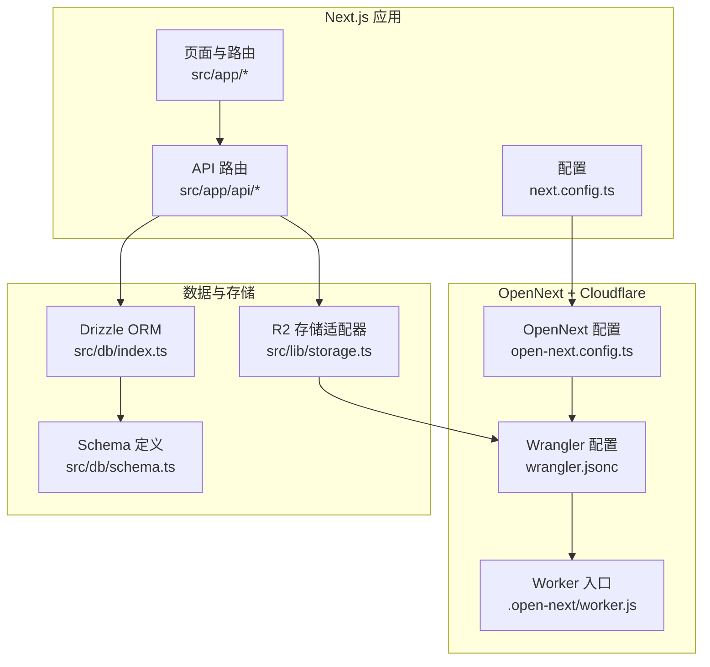
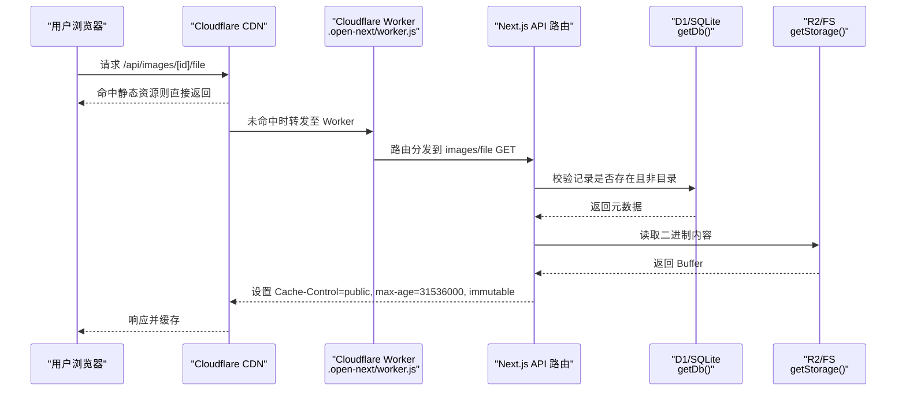
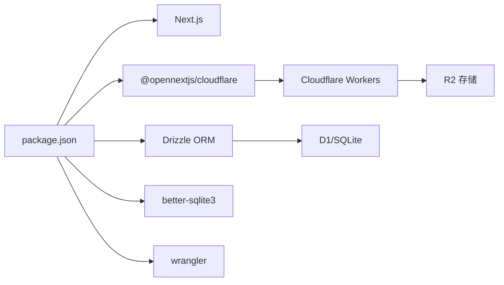

# 生产环境优化

<cite>
**本文引用的文件**   
- [next.config.ts](file://next.config.ts)
- [wrangler.jsonc](file://wrangler.jsonc)
- [open-next.config.ts](file://open-next.config.ts)
- [package.json](file://package.json)
- [drizzle.config.ts](file://drizzle.config.ts)
- [src/db/index.ts](file://src/db/index.ts)
- [src/db/schema.ts](file://src/db/schema.ts)
- [src/lib/storage.ts](file://src/lib/storage.ts)
- [src/lib/auth.ts](file://src/lib/auth.ts)
- [src/app/api/upload/route.ts](file://src/app/api/upload/route.ts)
- [src/app/api/images/route.ts](file://src/app/api/images/route.ts)
- [src/app/api/images/[imageId]/file/route.ts](file://src/app/api/images/[imageId]/file/route.ts)
- [src/app/api/channel/avatar/[channelId]/route.ts](file://src/app/api/channel/avatar/[channelId]/route.ts)
</cite>

## 目录
1. [简介](#简介)
2. [项目结构](#项目结构)
3. [核心组件](#核心组件)
4. [架构总览](#架构总览)
5. [详细组件分析](#详细组件分析)
6. [依赖分析](#依赖分析)
7. [性能考虑](#性能考虑)
8. [故障排查指南](#故障排查指南)
9. [结论](#结论)
10. [附录](#附录)

## 简介
本指南面向 Weable 应用的生产环境优化，覆盖 Next.js 构建与部署、Cloudflare Workers 运行时调优、数据库（D1/SQLite）查询与连接优化、CDN 缓存策略、图片压缩与懒加载、监控告警与日志收集、错误追踪以及安全加固（CORS、限流、输入校验）。文档基于仓库现有实现进行解读，并提供可落地的优化建议与可视化图示。

## 项目结构
Weable 采用 Next.js 作为前端与 API 框架，通过 @opennextjs/cloudflare 将应用打包为 Cloudflare Workers 兼容的 Worker 入口；数据层使用 Drizzle ORM，运行期在 Cloudflare D1（或本地 SQLite）上执行；对象存储使用 R2（或本地文件系统）；鉴权支持 Cloudflare Access JWT 与 Cookie 会话。

图表来源
- [next.config.ts:1-15](file://next.config.ts#L1-L15)
- [open-next.config.ts:1-10](file://open-next.config.ts#L1-L10)
- [wrangler.jsonc:1-34](file://wrangler.jsonc#L1-L34)
- [src/db/index.ts:1-61](file://src/db/index.ts#L1-L61)
- [src/db/schema.ts:1-100](file://src/db/schema.ts#L1-L100)
- [src/lib/storage.ts:1-214](file://src/lib/storage.ts#L1-L214)

章节来源
- [next.config.ts:1-15](file://next.config.ts#L1-L15)
- [open-next.config.ts:1-10](file://open-next.config.ts#L1-L10)
- [wrangler.jsonc:1-34](file://wrangler.jsonc#L1-L34)
- [package.json:1-40](file://package.json#L1-L40)

## 核心组件
- 构建与部署配置：Next.js 基础配置、OpenNext Cloudflare 适配、Wrangler 绑定（D1、R2、Assets）。
- 数据访问层：Db 工厂根据运行环境选择 D1 或本地 SQLite，统一对外暴露 getDb()。
- 存储抽象：StorageAdapter 接口封装本地 FS 与 R2，按环境自动切换。
- 鉴权模块：解析 Cloudflare Access JWT 或 Cookie，确保用户存在并返回当前用户信息。
- API 路由：上传、列表、文件读取、头像读写等关键路径。

章节来源
- [src/db/index.ts:1-61](file://src/db/index.ts#L1-L61)
- [src/lib/storage.ts:1-214](file://src/lib/storage.ts#L1-L214)
- [src/lib/auth.ts:1-118](file://src/lib/auth.ts#L1-L118)
- [src/app/api/upload/route.ts:1-75](file://src/app/api/upload/route.ts#L1-L75)
- [src/app/api/images/route.ts:1-66](file://src/app/api/images/route.ts#L1-L66)
- [src/app/api/images/[imageId]/file/route.ts:1-48](file://src/app/api/images/[imageId]/file/route.ts#L1-L48)
- [src/app/api/channel/avatar/[channelId]/route.ts:1-64](file://src/app/api/channel/avatar/[channelId]/route.ts#L1-L64)

## 架构总览
下图展示请求从浏览器到 Next.js API、再到数据库与对象存储的完整链路，以及在 Cloudflare 平台上的缓存与边缘加速能力。

图表来源
- [src/app/api/images/[imageId]/file/route.ts:1-48](file://src/app/api/images/[imageId]/file/route.ts#L1-L48)
- [src/db/index.ts:1-61](file://src/db/index.ts#L1-L61)
- [src/lib/storage.ts:1-214](file://src/lib/storage.ts#L1-L214)
- [wrangler.jsonc:1-34](file://wrangler.jsonc#L1-L34)

## 详细组件分析

### Next.js 生产构建优化
- 代码分割与页面扩展：通过 pageExtensions 支持多种页面类型，利于按需拆分与增量编译。
- React StrictMode：开发期启用严格模式，有助于发现潜在问题。
- OpenNext 增量缓存：可通过启用 R2 增量缓存提升 SSR/ISR 性能（需结合 R2 绑定）。
- 建议补充：
  - 开启 Turbopack 构建（若版本支持）以缩短构建时间。
  - 合理拆分大依赖，避免将重型库引入客户端。
  - 针对静态资源启用强缓存与不可变标识，减少回源。

章节来源
- [next.config.ts:1-15](file://next.config.ts#L1-L15)
- [open-next.config.ts:1-10](file://open-next.config.ts#L1-L10)

### Cloudflare Workers 性能调优
- 内存限制：Workers 默认内存有限，应避免在请求中持有大对象；优先使用流式处理与分块读取。
- 执行时间：控制单次请求耗时，长任务应拆分为后台任务或使用队列。
- 并发处理：利用 CF 的边缘并发优势，避免阻塞 I/O；对热点数据做缓存。
- 观察性：已启用 observability，便于在生产环境采集指标与日志。

章节来源
- [wrangler.jsonc:1-34](file://wrangler.jsonc#L1-L34)

### 数据库查询优化（D1/SQLite）
- 连接管理：Db 工厂在 Cloudflare 上下文优先使用 D1，否则回退到本地 SQLite，避免重复创建连接。
- Schema 设计：主键使用 Base58 编码 UUIDv7，具备时间有序性，有利于范围扫描与索引效率。
- 查询计划：
  - 列表接口按 userId 过滤并按 mimeType 与 updatedAt 排序，建议在 (userId, mimeType, updatedAt) 建立复合索引以提升排序与过滤性能。
  - 目录校验与权限检查应复用同一条件，减少二次查询。
- 连接池：D1 由平台管理连接池；本地 SQLite 通过单例实例复用连接。

章节来源
- [src/db/index.ts:1-61](file://src/db/index.ts#L1-L61)
- [src/db/schema.ts:1-100](file://src/db/schema.ts#L1-L100)
- [src/app/api/images/route.ts:1-66](file://src/app/api/images/route.ts#L1-L66)

### 存储与对象缓存（R2/FS）
- 存储抽象：LocalStorageAdapter 与 R2StorageAdapter 实现统一接口，按环境自动切换。
- 头像存储：LocalAvatarStorage 与 R2AvatarStorage 提供独立命名空间，避免冲突。
- 缓存策略：
  - 图片文件读取接口设置长期不可变缓存，适合 CDN 缓存。
  - 头像接口设置短期缓存，兼顾更新时效。

章节来源
- [src/lib/storage.ts:1-214](file://src/lib/storage.ts#L1-L214)
- [src/app/api/images/[imageId]/file/route.ts:1-48](file://src/app/api/images/[imageId]/file/route.ts#L1-L48)
- [src/app/api/channel/avatar/[channelId]/route.ts:1-64](file://src/app/api/channel/avatar/[channelId]/route.ts#L1-L64)

### 鉴权与安全
- 身份解析：优先解析 Cloudflare Access JWT，其次回退 Cookie 会话；生产环境无有效凭证时抛出错误。
- 用户保障：首次访问自动写入用户表，保证后续查询一致性。
- 输入校验：ID 参数正则校验，防止路径穿越与非法字符。

章节来源
- [src/lib/auth.ts:1-118](file://src/lib/auth.ts#L1-L118)
- [src/app/api/channel/avatar/[channelId]/route.ts:1-64](file://src/app/api/channel/avatar/[channelId]/route.ts#L1-L64)
- [src/app/api/images/[imageId]/file/route.ts:1-48](file://src/app/api/images/[imageId]/file/route.ts#L1-L48)

### 上传与批量处理
- 上传限制：最大文件数、MIME 前缀校验、单文件大小上限。
- 流程顺序：先写存储再写元数据，失败时不污染元数据表。
- 父目录校验：仅允许指定类型的目录作为父节点，增强数据结构一致性。

章节来源
- [src/app/api/upload/route.ts:1-75](file://src/app/api/upload/route.ts#L1-L75)

### 图片压缩与懒加载
- 服务端压缩：可在上传阶段接入图像处理库（如 sharp）生成多尺寸缩略图，降低带宽。
- 客户端懒加载：对首屏外的图片使用 loading="lazy" 与 IntersectionObserver 预取。
- CDN 缓存：对静态图片设置强缓存与不可变标识，配合版本号或哈希文件名。

[本节为通用实践说明，不直接分析具体文件]

### CDN 缓存策略
- 静态资源：Cache-Control 设置为 public, max-age=31536000, immutable，最大化边缘缓存命中率。
- 动态资源：头像等短缓存，max-age=3600，平衡新鲜度与性能。
- 建议：对 SSR 页面启用 ISR 或 Edge Cache，结合 OpenNext 的 R2 增量缓存。

章节来源
- [src/app/api/images/[imageId]/file/route.ts:1-48](file://src/app/api/images/[imageId]/file/route.ts#L1-L48)
- [src/app/api/channel/avatar/[channelId]/route.ts:1-64](file://src/app/api/channel/avatar/[channelId]/route.ts#L1-L64)
- [open-next.config.ts:1-10](file://open-next.config.ts#L1-L10)

### 监控告警与日志收集
- 观测性：已在 Wrangler 中启用 observability，可采集请求指标与日志。
- 建议：
  - 在关键 API 增加结构化日志（请求 ID、用户 ID、耗时、状态码）。
  - 设置错误率与延迟阈值告警，结合 Cloudflare Analytics 与外部 APM。

章节来源
- [wrangler.jsonc:1-34](file://wrangler.jsonc#L1-L34)

### 安全加固（CORS、限流、输入验证）
- CORS：如需跨域，应在 API 层明确允许的 Origin、方法与头；生产环境尽量同源。
- 限流：在 Cloudflare 层启用 Rate Limiting，保护上传与敏感接口。
- 输入验证：对 ID、MIME、大小等进行严格校验，拒绝异常输入。

章节来源
- [src/app/api/upload/route.ts:1-75](file://src/app/api/upload/route.ts#L1-L75)
- [src/app/api/channel/avatar/[channelId]/route.ts:1-64](file://src/app/api/channel/avatar/[channelId]/route.ts#L1-L64)

## 依赖分析
- 运行时依赖：Next.js、React、Drizzle ORM、better-sqlite3、@opennextjs/cloudflare、wrangler。
- 构建工具链：pnpm、TypeScript、TailwindCSS、PostCSS。
- 平台绑定：D1 数据库、R2 对象存储、Assets 静态资源。

图表来源
- [package.json:1-40](file://package.json#L1-L40)
- [wrangler.jsonc:1-34](file://wrangler.jsonc#L1-L34)

章节来源
- [package.json:1-40](file://package.json#L1-L40)
- [drizzle.config.ts:1-8](file://drizzle.config.ts#L1-L8)

## 性能考虑
- 构建优化：
  - 启用 Turbopack（若可用），减少构建时间。
  - 拆分大依赖，避免客户端包过大。
- 运行时优化：
  - 使用流式处理与分块读取，避免内存峰值。
  - 热点数据缓存（CDN/Edge/内存），减少后端压力。
- 数据库优化：
  - 为高频查询字段建立合适索引，避免全表扫描。
  - 合并多次查询，减少往返次数。
- 存储优化：
  - 上传阶段生成多尺寸缩略图，按需返回。
  - 使用 R2 的分片上传与断点续传提升稳定性。

[本节为通用指导，不直接分析具体文件]

## 故障排查指南
- 数据库绑定缺失：
  - 现象：在 Cloudflare 上下文但缺少 D1/R2 绑定时抛出配置错误。
  - 排查：检查 wrangler.jsonc 中的 d1_databases 与 r2_buckets 绑定名称是否一致。
- 上传失败：
  - 现象：MIME 类型不符、文件过大、父目录不存在。
  - 排查：确认 ALLOWED_MIME_PREFIXES、MAX_FILE_SIZE_BYTES、parentId 校验逻辑。
- 鉴权失败：
  - 现象：生产环境无法解析用户。
  - 排查：确认 CF_Authorization 或 cf_access-jwt-assertion 是否正确传递。

章节来源
- [src/db/index.ts:1-61](file://src/db/index.ts#L1-L61)
- [src/lib/storage.ts:1-214](file://src/lib/storage.ts#L1-L214)
- [src/app/api/upload/route.ts:1-75](file://src/app/api/upload/route.ts#L1-L75)
- [src/lib/auth.ts:1-118](file://src/lib/auth.ts#L1-L118)

## 结论
通过对 Next.js 构建、Cloudflare Workers 运行时、数据库与存储层的系统优化，结合 CDN 缓存、监控告警与安全加固，Weable 在生产环境可获得更高的性能、稳定性与安全性。建议持续迭代索引设计与缓存策略，完善结构化日志与错误追踪，形成闭环的性能治理体系。

[本节为总结，不直接分析具体文件]

## 附录
- 常用命令：
  - 构建：pnpm build
  - 启动：pnpm start
  - 迁移：pnpm db:migrate
- 关键环境变量：
  - DB_PATH：本地 SQLite 路径
  - IMAGE_STORAGE_PATH：本地图片存储根目录
  - DEV_USER_*：开发环境模拟用户

章节来源
- [package.json:1-40](file://package.json#L1-L40)
- [src/db/index.ts:1-61](file://src/db/index.ts#L1-L61)
- [src/lib/storage.ts:1-214](file://src/lib/storage.ts#L1-L214)