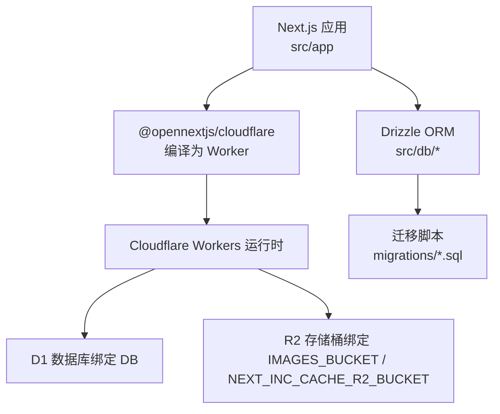
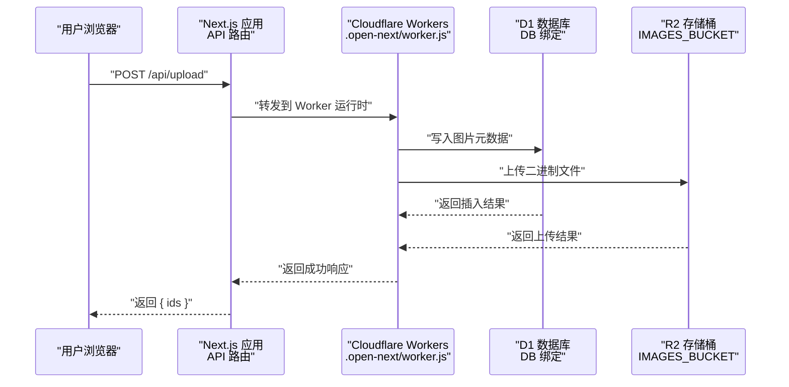
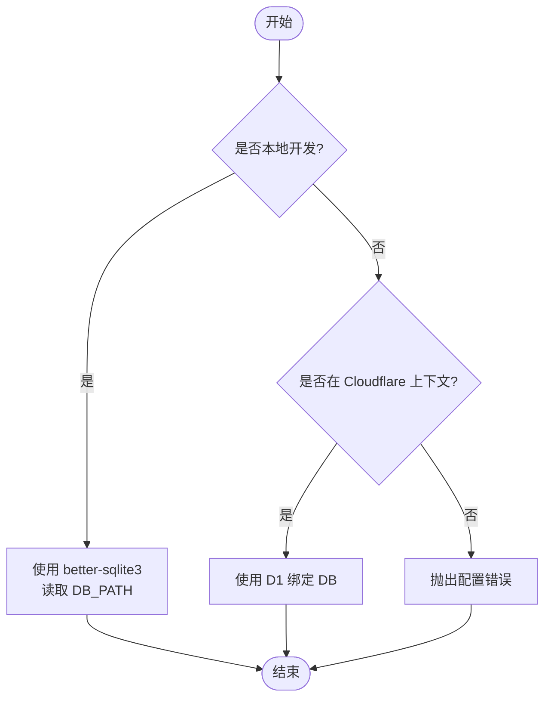
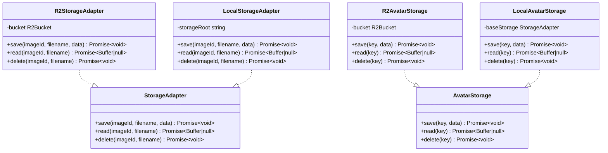
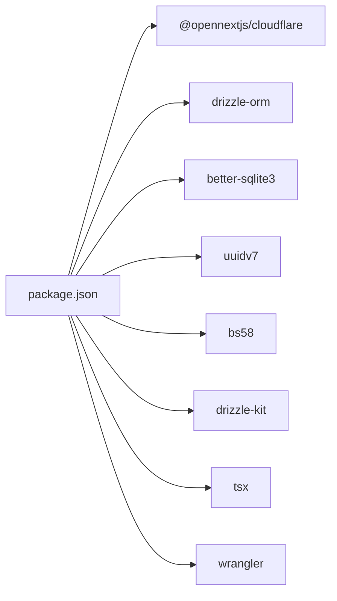

# 部署指南

<cite>
**本文引用的文件**   
- [wrangler.jsonc](file://wrangler.jsonc)
- [package.json](file://package.json)
- [drizzle.config.ts](file://drizzle.config.ts)
- [open-next.config.ts](file://open-next.config.ts)
- [next.config.ts](file://next.config.ts)
- [src/db/index.ts](file://src/db/index.ts)
- [src/db/migrate.ts](file://src/db/migrate.ts)
- [src/db/schema.ts](file://src/db/schema.ts)
- [migrations/0000_cynical_mordo.sql](file://migrations/0000_cynical_mordo.sql)
- [migrations/0001_happy_the_phantom.sql](file://migrations/0001_happy_the_phantom.sql)
- [src/lib/storage.ts](file://src/lib/storage.ts)
- [src/app/api/upload/route.ts](file://src/app/api/upload/route.ts)
- [src/app/api/images/route.ts](file://src/app/api/images/route.ts)
</cite>

## 目录
1. [简介](#简介)
2. [项目结构](#项目结构)
3. [核心组件](#核心组件)
4. [架构总览](#架构总览)
5. [详细组件分析](#详细组件分析)
6. [依赖关系分析](#依赖关系分析)
7. [性能考虑](#性能考虑)
8. [故障排查指南](#故障排查指南)
9. [结论](#结论)
10. [附录](#附录)

## 简介
本指南面向 Weable 应用，提供在 Cloudflare Workers 环境下的完整部署说明。内容涵盖：
- wrangler.jsonc 配置与环境变量
- D1 数据库初始化、迁移脚本执行与验证
- R2 存储桶配置与使用
- 本地开发环境搭建（Next.js + OpenNext + Wrangler）
- 生产部署最佳实践、性能优化与监控
- 常见问题与排障方法

Weable 基于 Next.js 构建，通过 @opennextjs/cloudflare 编译为 Cloudflare Workers 运行时，并使用 Drizzle ORM 管理 D1 数据库，R2 作为对象存储后端。

## 项目结构
- 应用入口与路由：src/app 下按功能划分页面与 API 路由
- 数据层：src/db 包含数据库连接、迁移与 Schema 定义
- 存储抽象：src/lib/storage.ts 统一封装本地与 R2 存储适配器
- 构建与部署：wrangler.jsonc、open-next.config.ts、next.config.ts、drizzle.config.ts
- 迁移脚本：migrations 目录下的 SQL 文件由 Drizzle 生成与管理

图表来源
- [wrangler.jsonc:1-34](file://wrangler.jsonc#L1-L34)
- [open-next.config.ts:1-10](file://open-next.config.ts#L1-L10)
- [next.config.ts:1-15](file://next.config.ts#L1-L15)
- [drizzle.config.ts:1-8](file://drizzle.config.ts#L1-L8)

章节来源
- [wrangler.jsonc:1-34](file://wrangler.jsonc#L1-L34)
- [package.json:1-40](file://package.json#L1-L40)
- [next.config.ts:1-15](file://next.config.ts#L1-L15)
- [open-next.config.ts:1-10](file://open-next.config.ts#L1-L10)
- [drizzle.config.ts:1-8](file://drizzle.config.ts#L1-L8)

## 核心组件
- 运行环境与构建
  - Next.js 应用通过 @opennextjs/cloudflare 打包为 Cloudflare Workers 入口 .open-next/worker.js
  - 静态资源输出至 .open-next/assets，并通过 assets 字段暴露给 Worker
- 数据库访问
  - getDb() 自动识别 Cloudflare 上下文，优先使用 D1 绑定；否则回退到本地 SQLite
- 存储适配
  - getStorage()/getAvatarStorage() 根据是否处于 Cloudflare 上下文选择 R2 或本地文件系统
- 迁移工具
  - drizzle-kit 管理 schema 与 migrations；迁移脚本位于 migrations 目录

章节来源
- [package.json:1-40](file://package.json#L1-L40)
- [wrangler.jsonc:1-34](file://wrangler.jsonc#L1-L34)
- [src/db/index.ts:1-61](file://src/db/index.ts#L1-L61)
- [src/lib/storage.ts:1-214](file://src/lib/storage.ts#L1-L214)
- [drizzle.config.ts:1-8](file://drizzle.config.ts#L1-L8)

## 架构总览
下图展示了请求从浏览器到 Cloudflare Workers、再到 D1 与 R2 的调用路径，以及本地开发时的回退策略。

图表来源
- [src/app/api/upload/route.ts:1-75](file://src/app/api/upload/route.ts#L1-L75)
- [src/db/index.ts:1-61](file://src/db/index.ts#L1-L61)
- [src/lib/storage.ts:1-214](file://src/lib/storage.ts#L1-L214)
- [wrangler.jsonc:1-34](file://wrangler.jsonc#L1-L34)

## 详细组件分析

### Cloudflare Workers 部署配置（wrangler.jsonc）
- name: 指定 Worker 名称
- compatibility_date/flags: 启用 nodejs_compat 等特性
- main: 指向 .open-next/worker.js（OpenNext 生成的入口）
- assets: 将 .open-next/assets 暴露为 ASSETS 绑定
- d1_databases: 绑定 DB 到 weable-db（含 database_name 与 database_id）
- r2_buckets: 绑定 IMAGES_BUCKET 与 NEXT_INC_CACHE_R2_BUCKET（可复用同一 bucket）

建议：
- 确保 database_id 与 database_name 与实际创建的一致
- 若启用 R2 增量缓存，需保证 NEXT_INC_CACHE_R2_BUCKET 绑定存在且命名正确

章节来源
- [wrangler.jsonc:1-34](file://wrangler.jsonc#L1-L34)

### 环境变量与依赖项管理
- 关键环境变量
  - DB_PATH：本地 SQLite 数据库路径（默认 ./.data/weable.db）
  - IMAGE_STORAGE_PATH：本地文件存储根路径（默认 ./.data/uploads）
- 依赖项
  - 运行时：@opennextjs/cloudflare、drizzle-orm、better-sqlite3（本地）、uuidv7、bs58 等
  - 开发时：drizzle-kit、tsx、wrangler、Next.js 生态

章节来源
- [package.json:1-40](file://package.json#L1-L40)
- [src/db/index.ts:1-61](file://src/db/index.ts#L1-L61)
- [src/lib/storage.ts:1-214](file://src/lib/storage.ts#L1-L214)

### D1 数据库初始化与迁移
- Schema 定义：src/db/schema.ts 定义 users、channels、images 表及关系
- 迁移脚本：migrations/*.sql 由 drizzle-kit 生成并维护版本
- 本地迁移：通过 tsx 执行 src/db/migrate.ts，写入本地 SQLite
- 云端迁移：在 CI/CD 中执行 drizzle-kit migrate 或使用 Wrangler 命令推送迁移

图表来源
- [src/db/index.ts:1-61](file://src/db/index.ts#L1-L61)
- [src/db/migrate.ts:1-24](file://src/db/migrate.ts#L1-L24)
- [drizzle.config.ts:1-8](file://drizzle.config.ts#L1-L8)

章节来源
- [src/db/schema.ts:1-100](file://src/db/schema.ts#L1-L100)
- [migrations/0000_cynical_mordo.sql:1-38](file://migrations/0000_cynical_mordo.sql#L1-L38)
- [migrations/0001_happy_the_phantom.sql:1-1](file://migrations/0001_happy_the_phantom.sql#L1-L1)
- [src/db/migrate.ts:1-24](file://src/db/migrate.ts#L1-L24)
- [drizzle.config.ts:1-8](file://drizzle.config.ts#L1-L8)

### R2 存储配置与使用
- 绑定名称：IMAGES_BUCKET（必需），NEXT_INC_CACHE_R2_BUCKET（可选，用于增量缓存）
- 存储适配器：R2StorageAdapter 与 LocalStorageAdapter 实现统一接口
- 头像存储：R2AvatarStorage / LocalAvatarStorage 以 avatar/ 前缀隔离

图表来源
- [src/lib/storage.ts:1-214](file://src/lib/storage.ts#L1-L214)

章节来源
- [src/lib/storage.ts:1-214](file://src/lib/storage.ts#L1-L214)
- [wrangler.jsonc:1-34](file://wrangler.jsonc#L1-L34)

### 开发环境搭建与调试
- 安装依赖：pnpm install
- 启动开发服务器：pnpm dev（Next.js 本地端口 7600）
- 本地数据库：设置 DB_PATH 指向 ./.data/weable.db，首次运行会创建目录与文件
- 本地存储：设置 IMAGE_STORAGE_PATH 指向 ./.data/uploads
- 调试技巧
  - 在 Cloudflare 上下文缺失时，getDb()/getStorage() 会回退到本地实现
  - 若检测到 Cloudflare 上下文但缺少绑定，会抛出明确错误提示检查 wrangler.jsonc

章节来源
- [package.json:1-40](file://package.json#L1-L40)
- [src/db/index.ts:1-61](file://src/db/index.ts#L1-L61)
- [src/lib/storage.ts:1-214](file://src/lib/storage.ts#L1-L214)

### 生产环境部署最佳实践
- 构建产物
  - 使用 @opennextjs/cloudflare 生成 .open-next/worker.js 与 .open-next/assets
  - 确认 next.config.ts 允许的开发源与扩展名配置符合预期
- 部署步骤
  - 登录 Cloudflare 并创建 D1 数据库 weable-db，记录 database_id
  - 创建 R2 存储桶 weable-images，并在 wrangler.jsonc 中绑定 IMAGES_BUCKET 与 NEXT_INC_CACHE_R2_BUCKET
  - 执行数据库迁移（CI/CD 中推荐自动化）
  - 发布 Worker：wrangler deploy
- 监控与观测
  - 启用 observability（已在 wrangler.jsonc 中开启）
  - 结合 Cloudflare Analytics 与自定义日志进行追踪

章节来源
- [wrangler.jsonc:1-34](file://wrangler.jsonc#L1-L34)
- [open-next.config.ts:1-10](file://open-next.config.ts#L1-L10)
- [next.config.ts:1-15](file://next.config.ts#L1-L15)

### 性能优化建议
- 启用 R2 增量缓存（uncomment open-next.config.ts 中的 incrementalCache 配置）
- 合理设置文件大小限制与并发上传数量（参考 upload 路由限制）
- 使用 D1 索引与查询优化（如 images.updatedAt 排序、parentId 过滤）
- 静态资源通过 assets 绑定直接分发，减少冷启动开销

章节来源
- [open-next.config.ts:1-10](file://open-next.config.ts#L1-L10)
- [src/app/api/upload/route.ts:1-75](file://src/app/api/upload/route.ts#L1-L75)
- [src/app/api/images/route.ts:1-66](file://src/app/api/images/route.ts#L1-L66)

## 依赖关系分析
- 运行时依赖
  - @opennextjs/cloudflare：Next.js 到 Cloudflare Workers 的桥接
  - drizzle-orm：数据库 ORM，支持 D1 与 SQLite
  - better-sqlite3：本地 SQLite 驱动
  - uuidv7、bs58：ID 生成与编码
- 开发依赖
  - drizzle-kit：Schema 与迁移管理
  - tsx：执行 TypeScript 脚本
  - wrangler：Cloudflare CLI

图表来源
- [package.json:1-40](file://package.json#L1-L40)

章节来源
- [package.json:1-40](file://package.json#L1-L40)

## 性能考虑
- 缓存策略
  - 启用 R2 增量缓存可减少重复渲染与数据库压力
- 存储与 I/O
  - R2 读写延迟较低，适合大规模图片存储与分发
  - 本地开发时使用文件系统，注意磁盘 I/O 对性能的影响
- 查询优化
  - 使用 parentId 与 updatedAt 排序提升列表加载速度
  - 避免不必要的 SELECT *，仅返回必要字段

[本节为通用指导，不直接分析具体文件]

## 故障排查指南
- 常见错误与解决
  - “Cloudflare D1 binding DB is not configured”：检查 wrangler.jsonc 的 d1_databases 绑定与 database_id
  - “Cloudflare R2 binding IMAGES_BUCKET is not configured”：检查 r2_buckets 绑定是否正确
  - 本地迁移失败：确认 DB_PATH 目录存在且有写权限
  - 上传失败：检查 MIME 类型与文件大小限制是否符合要求
- 调试步骤
  - 在本地开发时观察 getDb()/getStorage() 的回退行为
  - 查看 Cloudflare Observability 日志定位异常
  - 逐步验证 D1 与 R2 绑定可用性

章节来源
- [src/db/index.ts:1-61](file://src/db/index.ts#L1-L61)
- [src/lib/storage.ts:1-214](file://src/lib/storage.ts#L1-L214)
- [src/app/api/upload/route.ts:1-75](file://src/app/api/upload/route.ts#L1-L75)

## 结论
通过合理的 wrangler.jsonc 配置、D1 与 R2 绑定、以及规范的迁移流程，Weable 可在 Cloudflare Workers 上稳定运行。遵循本文的部署与优化建议，可有效提升性能与可维护性。建议在 CI/CD 中自动化迁移与部署，确保一致性。

[本节为总结，不直接分析具体文件]

## 附录
- 常用命令
  - 安装依赖：pnpm install
  - 本地开发：pnpm dev
  - 构建：pnpm build
  - 本地迁移：pnpm db:migrate
- 关键路径
  - Worker 入口：.open-next/worker.js
  - 静态资源：.open-next/assets
  - 数据库 Schema：src/db/schema.ts
  - 迁移脚本：migrations/*.sql
  - 存储适配器：src/lib/storage.ts

[本节为补充信息，不直接分析具体文件]