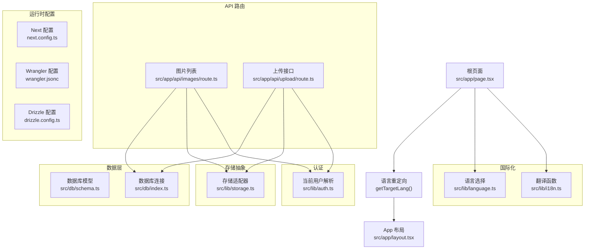
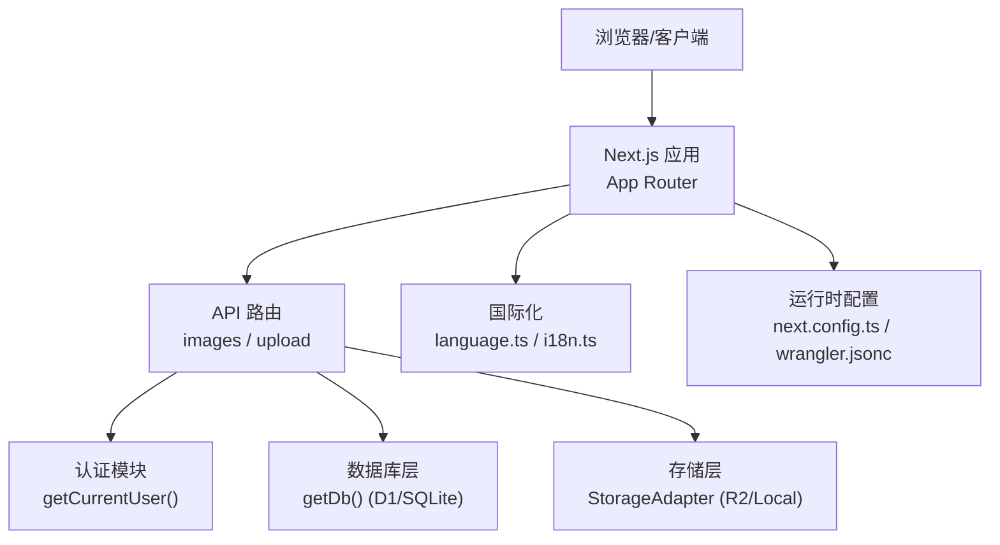
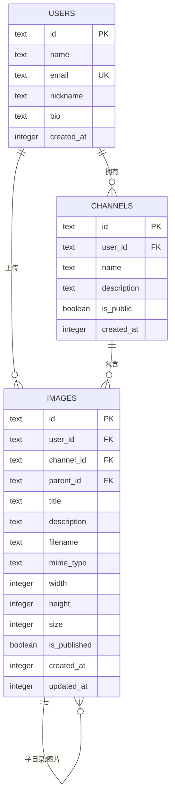
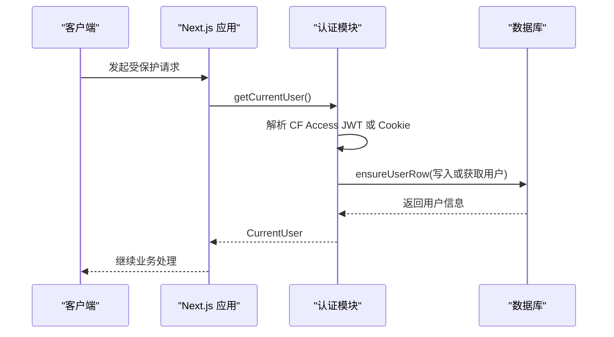
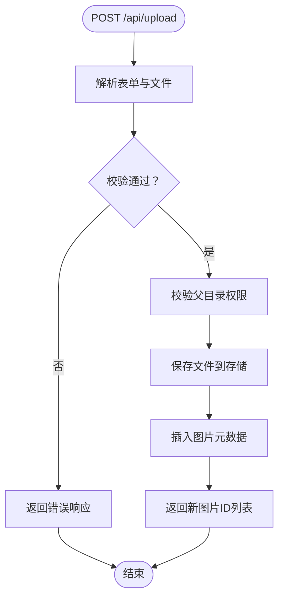
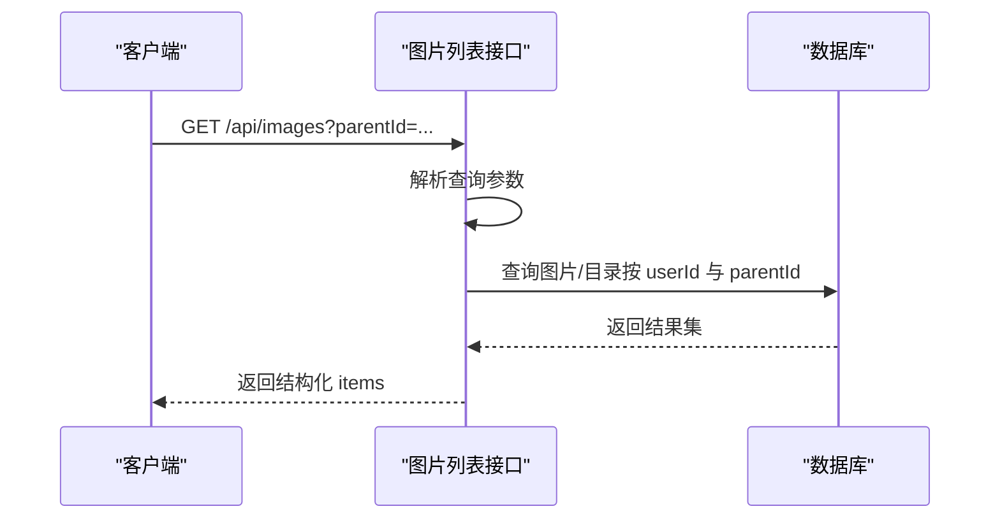
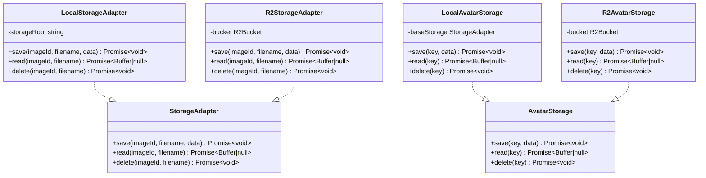
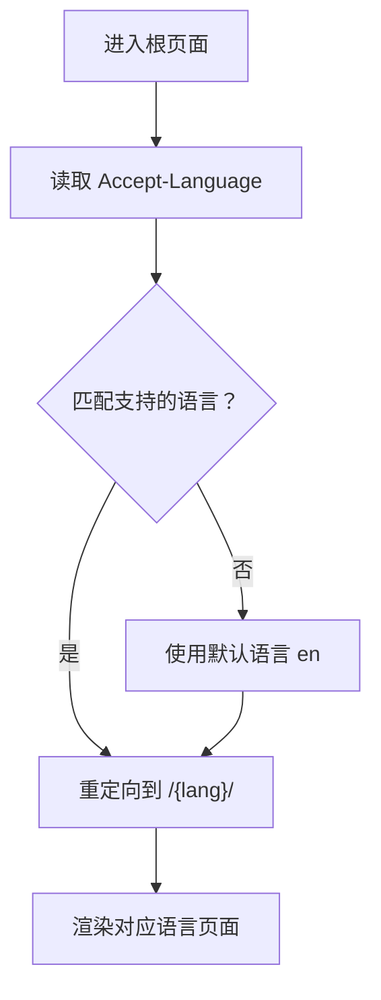
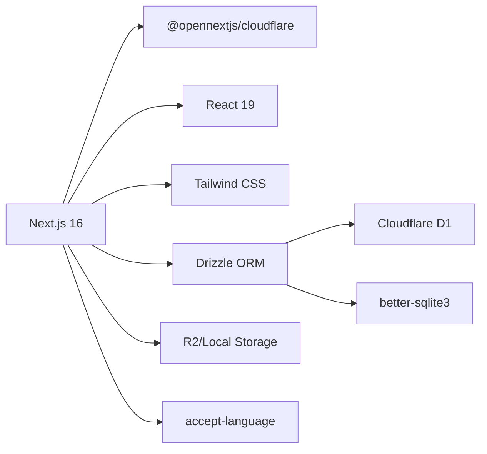

# 项目概述

<cite>
**本文引用的文件**   
- [README.md](file://README.md)
- [package.json](file://package.json)
- [next.config.ts](file://next.config.ts)
- [wrangler.jsonc](file://wrangler.jsonc)
- [drizzle.config.ts](file://drizzle.config.ts)
- [src/app/layout.tsx](file://src/app/layout.tsx)
- [src/app/page.tsx](file://src/app/page.tsx)
- [src/db/schema.ts](file://src/db/schema.ts)
- [src/lib/auth.ts](file://src/lib/auth.ts)
- [src/lib/i18n.ts](file://src/lib/i18n.ts)
- [src/lib/language.ts](file://src/lib/language.ts)
- [src/app/api/images/route.ts](file://src/app/api/images/route.ts)
- [src/app/api/upload/route.ts](file://src/app/api/upload/route.ts)
- [src/lib/storage.ts](file://src/lib/storage.ts)
- [src/db/index.ts](file://src/db/index.ts)
</cite>

## 目录
1. [简介](#简介)
2. [项目结构](#项目结构)
3. [核心组件](#核心组件)
4. [架构总览](#架构总览)
5. [详细组件分析](#详细组件分析)
6. [依赖关系分析](#依赖关系分析)
7. [性能考量](#性能考量)
8. [故障排查指南](#故障排查指南)
9. [结论](#结论)
10. [附录：快速开始与部署](#附录快速开始与部署)

## 简介
Weable 是一个基于 Next.js 16 与 Cloudflare Workers 构建的云原生图片管理系统。它提供多语言界面、用户认证、频道组织与树形目录结构，支持在 Cloudflare D1（SQLite）与 R2（对象存储）上运行，并通过 OpenNext 将 Next.js 应用适配到 Cloudflare Workers 环境。项目以 Drizzle ORM 作为数据访问层，结合 React 19 与 Tailwind CSS 实现现代化前端体验。

该项目的核心目标：
- 为个人与团队提供轻量、可移植的图片资源管理方案
- 通过树形目录与频道组织提升内容检索效率
- 借助云原生能力（D1/R2/Workers）获得高可用与弹性扩展
- 提供开箱即用的多语言界面与基础认证流程

**章节来源**
- [README.md:1-1](file://README.md#L1-L1)

## 项目结构
项目采用 Next.js App Router 的目录式路由组织，API 路由位于 src/app/api，业务逻辑与工具库集中在 src/lib，数据库模型与迁移位于 src/db 与 migrations，国际化文案位于 src/locales。

**图表来源**
- [src/app/page.tsx:1-13](file://src/app/page.tsx#L1-L13)
- [src/app/layout.tsx:1-8](file://src/app/layout.tsx#L1-L8)
- [src/app/api/images/route.ts:1-66](file://src/app/api/images/route.ts#L1-L66)
- [src/app/api/upload/route.ts:1-75](file://src/app/api/upload/route.ts#L1-L75)
- [src/db/schema.ts:1-100](file://src/db/schema.ts#L1-L100)
- [src/db/index.ts:1-61](file://src/db/index.ts#L1-L61)
- [src/lib/storage.ts:1-214](file://src/lib/storage.ts#L1-L214)
- [src/lib/language.ts:1-49](file://src/lib/language.ts#L1-L49)
- [src/lib/i18n.ts:1-28](file://src/lib/i18n.ts#L1-L28)
- [src/lib/auth.ts:1-118](file://src/lib/auth.ts#L1-L118)
- [next.config.ts:1-15](file://next.config.ts#L1-L15)
- [wrangler.jsonc:1-34](file://wrangler.jsonc#L1-L34)
- [drizzle.config.ts:1-8](file://drizzle.config.ts#L1-L8)

**章节来源**
- [package.json:1-40](file://package.json#L1-L40)
- [next.config.ts:1-15](file://next.config.ts#L1-L15)
- [wrangler.jsonc:1-34](file://wrangler.jsonc#L1-L34)
- [drizzle.config.ts:1-8](file://drizzle.config.ts#L1-L8)

## 核心组件
- 多语言与路由入口：根页面根据请求头 Accept-Language 自动重定向至对应语言路径，默认回退到英文。
- 认证模块：优先从 Cloudflare Access JWT 解析用户身份，其次回退到本地会话 Cookie；开发环境提供默认测试用户。
- 数据存储：通过 Drizzle ORM 抽象 SQLite/D1，运行时自动选择本地 SQLite 或 Cloudflare D1。
- 对象存储：统一 StorageAdapter 接口，支持本地文件系统与 Cloudflare R2，头像存储使用独立命名空间。
- API 路由：图片列表与上传接口均包含鉴权、参数校验、目录权限检查与持久化操作。

**章节来源**
- [src/app/page.tsx:1-13](file://src/app/page.tsx#L1-L13)
- [src/lib/auth.ts:1-118](file://src/lib/auth.ts#L1-L118)
- [src/db/index.ts:1-61](file://src/db/index.ts#L1-L61)
- [src/lib/storage.ts:1-214](file://src/lib/storage.ts#L1-L214)
- [src/app/api/images/route.ts:1-66](file://src/app/api/images/route.ts#L1-L66)
- [src/app/api/upload/route.ts:1-75](file://src/app/api/upload/route.ts#L1-L75)

## 架构总览
Weable 采用“前端 + API 路由 + 云原生后端”的分层架构：
- 前端：Next.js App Router 渲染页面与客户端交互
- API：Next.js Route Handlers 处理业务逻辑，调用数据与存储服务
- 数据层：Drizzle ORM 对接 D1/SQLite
- 存储层：R2/本地文件系统通过适配器解耦
- 运行时：OpenNext 将 Next.js 打包为 Cloudflare Worker，配合 Wrangler 管理绑定与资产

**图表来源**
- [src/app/api/images/route.ts:1-66](file://src/app/api/images/route.ts#L1-L66)
- [src/app/api/upload/route.ts:1-75](file://src/app/api/upload/route.ts#L1-L75)
- [src/lib/auth.ts:1-118](file://src/lib/auth.ts#L1-L118)
- [src/db/index.ts:1-61](file://src/db/index.ts#L1-L61)
- [src/lib/storage.ts:1-214](file://src/lib/storage.ts#L1-L214)
- [src/lib/language.ts:1-49](file://src/lib/language.ts#L1-L49)
- [src/lib/i18n.ts:1-28](file://src/lib/i18n.ts#L1-L28)
- [next.config.ts:1-15](file://next.config.ts#L1-L15)
- [wrangler.jsonc:1-34](file://wrangler.jsonc#L1-L34)

## 详细组件分析

### 数据模型与关系
Weable 的数据模型围绕用户、频道与图片展开，图片支持树形结构（父子关系），并可通过频道进行归类。

**图表来源**
- [src/db/schema.ts:26-99](file://src/db/schema.ts#L26-L99)

**章节来源**
- [src/db/schema.ts:1-100](file://src/db/schema.ts#L1-L100)

### 认证流程
认证模块优先解析 Cloudflare Access JWT，失败时回退到本地会话 Cookie；开发环境提供默认用户以便快速调试。

**图表来源**
- [src/lib/auth.ts:93-117](file://src/lib/auth.ts#L93-L117)
- [src/db/schema.ts:26-33](file://src/db/schema.ts#L26-L33)

**章节来源**
- [src/lib/auth.ts:1-118](file://src/lib/auth.ts#L1-L118)

### 图片上传流程
上传接口对文件类型、数量与大小进行校验，校验通过后写入对象存储并在数据库中创建记录。

**图表来源**
- [src/app/api/upload/route.ts:14-74](file://src/app/api/upload/route.ts#L14-L74)
- [src/lib/storage.ts:184-197](file://src/lib/storage.ts#L184-L197)

**章节来源**
- [src/app/api/upload/route.ts:1-75](file://src/app/api/upload/route.ts#L1-L75)
- [src/lib/storage.ts:1-214](file://src/lib/storage.ts#L1-L214)

### 图片列表与树形展示
列表接口按 mimeType 区分目录与普通图片，优先返回目录项并按更新时间排序，支持按 parentId 过滤子节点。

**图表来源**
- [src/app/api/images/route.ts:9-65](file://src/app/api/images/route.ts#L9-L65)

**章节来源**
- [src/app/api/images/route.ts:1-66](file://src/app/api/images/route.ts#L1-L66)

### 存储适配器设计
存储层通过统一接口屏蔽底层差异，Cloudflare 环境下优先使用 R2，否则回退到本地文件系统。头像存储使用独立命名空间以避免冲突。

**图表来源**
- [src/lib/storage.ts:3-13](file://src/lib/storage.ts#L3-L13)
- [src/lib/storage.ts:61-114](file://src/lib/storage.ts#L61-L114)
- [src/lib/storage.ts:116-136](file://src/lib/storage.ts#L116-L136)
- [src/lib/storage.ts:138-179](file://src/lib/storage.ts#L138-L179)

**章节来源**
- [src/lib/storage.ts:1-214](file://src/lib/storage.ts#L1-L214)

### 国际化与语言选择
根页面根据 Accept-Language 自动选择语言并重定向，i18n 模块集中管理多语言文案并提供 t 函数用于取值。

**图表来源**
- [src/app/page.tsx:7-12](file://src/app/page.tsx#L7-L12)
- [src/lib/language.ts:40-44](file://src/lib/language.ts#L40-L44)
- [src/lib/i18n.ts:25-27](file://src/lib/i18n.ts#L25-L27)

**章节来源**
- [src/app/page.tsx:1-13](file://src/app/page.tsx#L1-L13)
- [src/lib/language.ts:1-49](file://src/lib/language.ts#L1-L49)
- [src/lib/i18n.ts:1-28](file://src/lib/i18n.ts#L1-L28)

## 依赖关系分析
- 运行时与框架：Next.js 16、React 19、Tailwind CSS
- 数据访问：Drizzle ORM（SQLite/D1）
- 云原生：OpenNext 适配 Cloudflare Workers，Wrangler 管理绑定与资产
- 存储：Cloudflare R2（生产）、本地文件系统（开发）
- 其他：accept-language、uuidv7、bs58、marked、sanitize-html

**图表来源**
- [package.json:11-24](file://package.json#L11-L24)
- [wrangler.jsonc:16-32](file://wrangler.jsonc#L16-L32)
- [drizzle.config.ts:1-8](file://drizzle.config.ts#L1-L8)

**章节来源**
- [package.json:1-40](file://package.json#L1-L40)
- [wrangler.jsonc:1-34](file://wrangler.jsonc#L1-L34)
- [drizzle.config.ts:1-8](file://drizzle.config.ts#L1-L8)

## 性能考量
- 数据库连接复用：Db 实例缓存避免重复初始化，减少冷启动开销
- 存储适配器单例：StorageAdapter 与 AvatarStorage 单例化，降低对象创建成本
- 查询优化：图片列表按 mimeType 与 updatedAt 排序，优先返回目录项以提升导航效率
- 上传限流：限制单次上传文件数量与大小，防止滥用与过载
- 云原生优势：Workers 无服务器执行、D1/R2 高可用与就近读写，适合全球分发

[本节为通用指导，不直接分析具体文件]

## 故障排查指南
- 无法解析用户：检查 Cloudflare Access JWT 是否传入，或确认本地会话 Cookie 是否存在；开发环境需确保环境变量正确
- 数据库未配置：在 Cloudflare 环境中需配置 D1 绑定；本地开发需确保 DB_PATH 指向有效路径
- 对象存储未配置：在 Cloudflare 环境中需配置 R2 绑定；本地开发将回退到文件系统
- 上传失败：检查 MIME 类型、文件大小与父目录权限；确认存储适配器可用

**章节来源**
- [src/lib/auth.ts:93-117](file://src/lib/auth.ts#L93-L117)
- [src/db/index.ts:43-60](file://src/db/index.ts#L43-L60)
- [src/lib/storage.ts:184-213](file://src/lib/storage.ts#L184-L213)
- [src/app/api/upload/route.ts:14-49](file://src/app/api/upload/route.ts#L14-L49)

## 结论
Weable 通过 Next.js 16 与 Cloudflare Workers 构建了高性能、可扩展的图片管理系统。其清晰的模块化设计、统一的存储与数据库抽象、完善的认证与国际化支持，使其既适合本地开发调试，也便于在生产环境快速部署。树形目录与频道组织提升了内容管理能力，而云原生基础设施则保障了稳定性与全球可达性。

[本节为总结性内容，不直接分析具体文件]

## 附录：快速开始与部署
- 安装依赖：使用 pnpm 安装项目依赖
- 本地开发：启动 Next.js 开发服务器（端口 7600），默认使用本地 SQLite 与文件系统存储
- 数据库迁移：执行迁移脚本同步 schema
- 部署到 Cloudflare：使用 Wrangler 构建并部署，确保 D1 与 R2 绑定已配置

参考命令与配置：
- 开发：pnpm dev
- 构建：pnpm build
- 启动：pnpm start
- 迁移：pnpm db:migrate

**章节来源**
- [package.json:5-10](file://package.json#L5-L10)
- [wrangler.jsonc:1-34](file://wrangler.jsonc#L1-L34)
- [drizzle.config.ts:1-8](file://drizzle.config.ts#L1-L8)